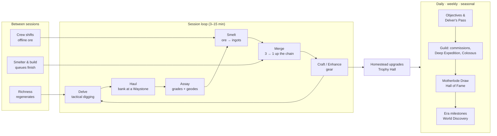

# 02 · Game Design Document (GDD)

This document is the master description of what the player sees and does. Details live in:
- [03](03-delve-and-combat-design.md): delve and combat rules
- [04](04-economy-and-progression.md): numbers and economy
- [05](05-multiplayer-guilds-and-territory.md): social systems
- [06](06-live-operations-and-events.md): events

Content ids and tables are in [Appendix B](appendices/B-content-tables.md).

**Scope tags** used throughout the docs:

| Tag | Meaning | Timing |
|---|---|---|
| `M1` … `M6` | Built in that milestone; part of the launch build | See [20](20-project-plan.md) |
| `L+1` | First live update | About 6–8 weeks after launch |
| `L+2` | Second live update | About realm day 91 |
| `L+3` | Third live update | About 6 months after launch |
| `Future` | Not scheduled | — |

---

## 2.1 World and tone

**Setting: the Hollowlands.** Highland frontier villages sit above *the Deep*: layered strata of older worlds, each era of civilization buried under the next. Your grandfather's claim, an abandoned **Homestead** at the mouth of Copperhollow, comes to you in a letter. Clear it, relight the forge, and dig.

- **Tone:** warm, curious and lightly humorous. The Deep is mysterious, not grim. Monsters are critters and old automatons, not gore.
- **Narrative delivery:**
  - one-screen letters and journal entries;
  - NPC barks at the Homestead;
  - server-wide **World Discovery** story beats ([06 §6.6](06-live-operations-and-events.md#66-world-discovery-events)).
  - No long cutscenes.
- **Art direction:**
  - 2D, super-deformed (SD) characters at about 2.5 heads tall. This proportion is popular with the target market.
  - Saturated earth tones underground; warm lantern light.
  - Rarity colors (accessible: always paired with a shape or icon):
    - Common: grey, circle
    - Uncommon: green, diamond
    - Rare: blue, shield
    - Epic: purple, star
    - Legendary: gold, sun
  - Festive events use red and gold.
- **Audio:**
  - Tactile percussive mining: *tink* for a hit, *crunch* for a break, a bright chime for ore.
  - Acoustic folk loops on the surface; low ambient drones in the Deep that rise in pitch as oil runs low.

## 2.2 Core loops

| Loop | Length | Player goal | Systems involved | Primary pillar |
|---|---|---|---|---|
| Moment | 1 tap (about 0.8–1.5 s) | Break, move, strike, read intent | Delve sim | P1 |
| Run | 3–6 min | Get deeper, fill the cart, bank safely | Delve, oil, waystones | P1 |
| Session | 5–15 min | Assay, smelt, merge, craft one upgrade | Homestead | P1, P2 |
| Day | 2–6 sessions | Daily objectives, collect crew output, use richness | Objectives, crew, richness | P2 |
| Week | 7 days | Guild Deep Expedition, Colossus, Motherlode Draw, Deep Rift record | Guild, draw, events | P3, P5 |
| Season | 6 weeks | Pass track, seasonal leaderboards, Claims (L+3) | Season | P4 |
| Era | About 3 months per era | New materials, recipes, sites; HH ceiling raised | Realm milestones | P2, P4 |

## 2.3 System overview

| System | Summary | Scope | Detail |
|---|---|---|---|
| **Delve** | Turn-based dig on a 7×9 grid per floor, down to floor 10–15 per site; oil limits turns; waystones every 5 floors let you bank and surface | M1 | [03](03-delve-and-combat-design.md) |
| **Richness** | Each site's yield multiplier per player falls 10% per delve (floor 25%) and recovers 5% per hour. It encourages variety and protects against bots and burnout | M2 | [04 §4.4](04-economy-and-progression.md#44-yield-and-richness) |
| **Assay** | Reveals chunk grade (C/B/A/S) and geodes; fee 1 coin per chunk; odds shown; pity at 250 | M1 | [§2.5](#25-the-assay-ritual) |
| **Smelter** | Timed queue: ore → ingots; alloying Bronze uses coal | M1 | [04 §4.6](04-economy-and-progression.md#46-refining-and-merging) |
| **Forge: Merge** | Instant 3→1 merge: Ingot → Fitting → Component → Assembly; small coin fee | M1 | [04 §4.6](04-economy-and-progression.md#46-refining-and-merging) |
| **Forge: Craft** | Recipes for Pick, Lamp, Kit and Trinkets; quality follows assay grades | M1 | [04 §4.7](04-economy-and-progression.md#47-crafting-gear-and-enhancement) |
| **Enhancement** | +0 to +10; never fails (ADR-016); cap = Homestead Hall level | M2 | [B §B.7](appendices/B-content-tables.md#b7-enhancement) |
| **Homestead** | 8 buildings; Homestead Hall (HH) 1–15 gates everything else | M2 | [§2.6](#26-the-homestead) |
| **Crew** | Hired NPC miners; idle ore and coal; offline cap 12 h | M3 | [§2.7](#27-crew) |
| **Vocations** | Guardian, Ranger, Engineer; switchable; 3 specializations each at vocation level 10 | M2–M3 | [03 §3.7](03-delve-and-combat-design.md#37-vocations-and-skills) |
| **Professions** | Mining, Smithing, Prospecting at launch; Trade and Leadership later | M3 | [§2.8](#28-professions) |
| **Collections** | 18 relics in 3 sets at launch; Mineralogy Index; Trophy Hall display and bonuses | M3 | [§2.9](#29-collections-and-the-trophy-hall) |
| **Objectives** | 5 daily, 5 weekly; season objectives feed the Pass | M3 | [§2.10](#210-objectives) |
| **Mail** | System rewards, compensation, Charter Aurum | M3 | [11](11-api-specification.md) |
| **Friends** | Up to 50 friends, visits, daily gifts | M4 | [05 §5.2](05-multiplayer-guilds-and-territory.md#52-friends-visits-and-gifts) |
| **Guilds** | Up to 30 members; commissions, research, Deep Expedition, Colossus | M4 | [05](05-multiplayer-guilds-and-territory.md) |
| **Leaderboards** | 7 boards per realm; seasonal and weekly | M4 | [05 §5.5](05-multiplayer-guilds-and-territory.md#55-leaderboards-and-fame) |
| **Motherlode Draw** | Free weekly draw per realm | M4 | [06 §6.5](06-live-operations-and-events.md#65-the-motherlode-draw) |
| **Store** | Aurum packs, Charter, Pass, crates, cosmetics | M4 | [07](07-monetization-and-business-model.md) |
| **Eras** | Realm-wide milestones; Era II at realm day 15 or later | M4 | [§2.11](#211-eras-and-realm-progression) |
| **Proving Grounds** | Async PvP against defense snapshots; normalized stats | L+1 | [05 §5.6](05-multiplayer-guilds-and-territory.md#56-proving-grounds-arena-l1) |
| **Trade Contracts** | Escrowed material trades with price bands | L+2 | [05 §5.7](05-multiplayer-guilds-and-territory.md#57-trade-contracts-l2) |
| **Claims** | Seasonal guild territory with scheduled windows | L+3 | [05 §5.8](05-multiplayer-guilds-and-territory.md#58-claims-territory-l3) |

## 2.4 The Delve (summary)

Full rules are in [03](03-delve-and-combat-design.md).

1. **Choose a site and a start floor.** You can start from any reached waystone, i.e. floor 1, 5, 10 and so on. Each site card shows its richness percentage.
2. **Play the floor.** The grid is 7 columns × 9 rows. Tap an adjacent tile:
   - empty → move;
   - dirt, stone or ore → mine it (damage equals your mining power, MPW);
   - monster → attack.
   Skills are on two buttons. Every action is one turn and burns one unit of oil. After each turn, monsters do what their intent icons showed.
3. **Find the stairs** on the bottom row and descend. On floors 5, 10 and 15 the stairs are a **Waystone**: you may **Surface** there and bank everything.
4. **Risk:** if HP reaches 0 you **faint**, keep 50% of unbanked chunks (rounded down) and return. Gear is never lost. Out of oil, the dark costs 1 HP per turn.
5. **Results:** the server replays your action log, converts broken tiles into chunks using richness and mining bonuses, and credits your haul.

**Why it is fun** (the M1 hypothesis to test):
- spatial puzzles (which tiles to dig to reach ore without opening a monster pocket);
- breakpoint satisfaction (a better pick turns 3-tap tiles into 2-tap tiles);
- push-your-luck (bank at floor 5, or push for floor 10 and the boss).

## 2.5 The Assay ritual

The Assay is the game's signature "lucky moment" (ADR-010).

1. After a delve, unassayed chunks appear on the Assay Office table, grouped by ore.
2. Tap **Assay all** to spend the fee. Charter members also get auto-assay.
3. Each chunk flips to show its **grade**:

   | Grade | Chance | Ore units | Effect |
   |---|---|---|---|
   | C | 60% | 1 | — |
   | B | 30% | 1 | Small quality bonus |
   | A | 9% | 2 | Quality bonus |
   | S | 1% | 3 | Large quality bonus; triggers a gold shimmer animation |

   Expected yield is 1.11 ore units per chunk.
4. Some chunks crack open as **Geodes**, with a distinct sound and camera shake. Geode contents:
   - Gem: 70%. Used in Trinkets.
   - Relic: 25%. A collectible.
   - Starstone shard: 5%.
5. The **Prospector's Instinct** meter (pity) fills with every chunk without a geode. At 250 the next chunk is guaranteed to be a geode. The meter is always visible.
6. A **"Show odds"** button lists every table in the current content version, plus the player's Prospecting bonus. Odds are disclosed even though nothing here is paid, because we want that trust.

Cosmetic-only variation is allowed (S-grade animation skins sold as cosmetics). Odds can never be changed by purchase. That is a hard rule, enforced in code: assay odds read only content data and Prospecting level.

## 2.6 The Homestead

The Homestead is the persistent home screen: a side-on cutaway of a hillside camp above the mine mouth. Buildings level visibly, and the camp grows from tents to timber to brick to bronze-trimmed halls.

| Building | Id | Role | Levels at launch | Unlock |
|---|---|---|---|---|
| Homestead Hall | `hall` | Gates all building levels and enhancement cap; crew slots; prestige | 1–15 | Start |
| Smelter | `smelter` | Ore → ingot queues; slots 1→3; batch cap 20→130 | 1–12 (≤ HH) | Start |
| Forge | `forge` | Merge bench (instant) and craft queue (1 slot; 2 at HH 9) | 1–12 (≤ HH) | Start |
| Assay Office | `assay_office` | Assay; at higher levels shows the expected geode chance per site | 1–10 | Tutorial |
| Warehouse | `warehouse` | Soft storage cap. Production pauses when full; nothing is lost | 1–12 | HH 2 |
| Crew Quarters | `crew_quarters` | Crew roster and hiring; slots come from HH | 1–8 | HH 3 |
| Trophy Hall | `trophy_hall` | Displays relics and achievements; set bonuses; visitors see it | 1–10 | First relic |
| Workshop | `workshop` | Trinket crafting with gems and relics; Maker's Mark later | 1–8 | HH 6 |

**Builder rule:** one building upgrades at a time (enforced by `building_one_builder` in the schema). Hasten (Aurum, capped at 480 min per day) can shorten timers.

**Decoration:** cosmetic decor slots grow with HH level. Decor is earned or bought and has **no stat effect**, except Trophy Hall set bonuses, which only come from earned relics.

## 2.7 Crew

- **Slots by HH level:** 2 at HH 1, then 3 at HH 3, 4 at HH 5, 5 at HH 7, 6 at HH 9, 7 at HH 11, and 8 at HH 13.
- **Hiring:** each realm day, three candidates appear at the Crew Quarters board, each with visible **traits**:

  | Trait | Effect |
  |---|---|
  | Sturdy | +15% ore |
  | Steady | +2 h offline cap for this crew member |
  | Coal-Wise | +50% coal |
  | Lucky | 2% of shift ore is grade B |

  Hire one for coins (200, 320, 510, 820, 1,310, 2,100 for crew #3–8). Refreshing the board costs coins (100, doubling per refresh, reset daily). **No paid random recruitment.**
- **Specialists:** named crew earned from achievements, events and the Motherlode Draw consolation track. Example: "Old Hollis", who has two traits. Never sold.
- **Output:** each crew member produces 1 ore unit and 0.6 coal per hour from the player's unlocked sites. Output is copper in Era I, and half copper, half tin once Tinreach unlocks. It accumulates for up to 12 hours (16 with the Charter). Crew ore is surface ore: grade C, no assay, no geodes. That keeps active play the only source of rare finds.

## 2.8 Professions

Professions level independently of character level. This is the "many ways to be great" pillar (study/06 §4).

| Profession | XP source | Effect per level (cap 50) | Leaderboard |
|---|---|---|---|
| Mining | Chunks mined | +1% chunk yield (cap +50%) | Mining Yield (season) |
| Smithing | Ingots smelted, merges, crafts | +0.5 craft quality; unlocks recipe variants at 10/20/30 | Crafting Mastery (season) |
| Prospecting | Chunks assayed | +0.02 percentage points geode chance (cap +1 pp); Assay Office hints | Collection Score |
| Trade (`L+2`) | Contracts fulfilled | Lower contract fee (5% → 3%) | Market Innovator |
| Leadership (`M4`) | Guild contributions organized; commissions filled | Guild research speed when in the officer role | Guild Strategist |

Mining level formula: `floor(sqrt(chunks_mined / 10))`, so 1,000 chunks gives level 10 and 25,000 gives level 50.

## 2.9 Collections and the Trophy Hall

| Set (id) | Relics | Source | Set bonus (permanent) |
|---|---|---|---|
| Settler's Keepsakes (`set.settlers_keepsakes`) | 6 | Geodes in Copperhollow and Emberseam | +2% chunk yield |
| Wyrm Hoard (`set.wyrm_hoard`) | 6 | Geodes in Emberseam; Tunnel Wyrm first clear | +1 crew slot (counted in addition to HH slots) |
| Bronze Works (`set.bronze_works`) | 6 | Geodes in Tinreach; Bronze Sentinel | +5 lamp oil |

**Duplicate protection:**
- A duplicate relic converts to 25 **Relic Dust**.
- 100 Relic Dust crafts any specific missing relic from an unlocked set (the "targeted craft", a lesson from Pokémon TCG Pocket's pack points, C27).

**Measured completion time** ([D §D.5](appendices/D-economy-simulation.md#d5-collection-completion)): completing all 18 relics from geodes alone takes 62.7 relics on average by pure luck, or 31.5 with dust exchange.

| Player | Relics per day | Days with dust exchange | Days by pure luck |
|---|---|---|---|
| Engaged | 0.52 | ≈ 61 | ≈ 121 |
| Casual | 0.17 | ≈ 183 | — |

Six months is too long for casual players, so the launch build adds **guaranteed sources** on top of geodes:
1. Each site boss's first clear lets the player **choose** one relic from that site's set (3 relics at launch).
2. The guild weekly Deep Expedition chest contains 25 Relic Dust.
3. Achievements in the Mineralogy Index award 50 dust each.

The simulation figure is therefore the worst case. The M3 target is that a casual player completes the first set within 30 days.

**Mineralogy Index:** first discoveries of each ore at each grade, each gem and each monster. It gives titles and a Collection Score.

## 2.10 Objectives

- **Daily objectives:** 5 each day. Completing them gives Coins, XP, Pass XP and 1 draw ticket for the full set.
- **Weekly objectives:** 5 each week. They give more Pass XP, 2 draw tickets for the full set, and guild contribution.
- **Variety rule:** objectives are drawn from category pools so each set touches at least 3 systems. Example daily set: "Delve to floor 5 in any site", "Assay 30 chunks", "Merge 6 times", "Defeat 8 monsters", "Help a guildmate's commission".
- **Catch-up:** missed daily sets bank as "Rested Objectives". Up to 2 days of rewards can be claimed by completing double targets. This avoids punishing missed days (study/06 §9B).

## 2.11 Eras and realm progression

| Era | Theme | Launch status | Gate (realm) | New content |
|---|---|---|---|---|
| I · Settlement | Timber camps, copper | Launch | Realm opens | Copperhollow, Emberseam; copper gear; HH 1–8; player level cap 20 |
| II · Bronze | Alloys, specialists | Launch | Day ≥ 15 **and** community milestone "Bronze Discovery" (tin delivered realm-wide) | Tinreach; bronze and Starstone gear; HH 9–15; player level cap 40 |
| III · Iron Kingdoms | Fortification | `L+2` (about day 91) | Day ≥ 91 and milestone | Iron; claims readiness; recipes that still consume bronze and copper (keeps old materials useful) |
| IV–VII | Crystal, Steam, Ancient, Astral | `Future` | — | Per [study/06 §1](../study/06-expanded-vision-eras-merging-classes.md) |

If the milestone completes before the calendar gate, the era unlocks the moment the gate opens. If the gate opens first, a server-wide progress bar shows the remaining milestone. This is the shared story beat (World Discovery, [06 §6.6](06-live-operations-and-events.md#66-world-discovery-events)).

## 2.12 First-time user experience (FTUE)

The target is the first 15 minutes, with no screen held longer than 20 seconds without the player acting. Every step is a server-tracked `tutorial_step` event ([16](16-analytics-and-kpis.md)).

| Time | Beat | Player action | Teaches | Reward |
|---|---|---|---|---|
| 0:00 | Language/age gate; guest account created silently | Confirm birth year | — | — |
| 0:20 | Letter from grandfather (one screen, skippable) | Tap | Premise | — |
| 0:40 | Scripted floor (fixed seed `tutorial-1`) | Dig 3 dirt, 2 stone | Tap = mine/move; MPW and HP numbers | — |
| 1:30 | First copper vein | Mine it | Ore sparkle, chunk count | Chunks |
| 2:00 | Cave Rat with intent arrow | Read intent; attack | Telegraphs; damage numbers | — |
| 3:00 | Stairs; floor 2 (still scripted) | Descend | Oil gauge; stairs | — |
| 4:30 | Surface (the tutorial allows surfacing at floor 2) | Surface | Banking | Haul |
| 5:00 | Assay Office | Assay all | Grades; **guaranteed scripted geode with a relic** | First relic, Trophy Hall unlock |
| 6:30 | Smelter | Queue a batch (the first batch completes instantly) | Smelting | Ingots |
| 7:30 | Forge: merge 3→1 twice; craft **Copper Pick** with the strongbox ingots | Merge, craft | Merge chain; gear | Copper Pick (MPW 12) |
| 9:00 | Homestead Hall → level 2 (5 min, first Hasten is free) | Upgrade | Builder, Hasten | HH 2 |
| 10:00 | Free delve, Copperhollow floor 1 | Play | Real seed; richness shown | — |
| 14:00 | Daily objectives and draw ticket explained | Claim | Objectives; draw | Coins, ticket |
| 15:00 | Name your Delver (moved late, so players are invested before naming) | Enter name | — | Title "Greenhorn" |

Start inventory: 27 copper ingots (the "grandfather's strongbox"), 700 coins, 60 stone, 20 coal. These values match the simulation ([04 §4.12](04-economy-and-progression.md#412-pacing-targets-and-simulated-results)).

## 2.13 Player journeys (scenarios)

These scenarios serve as acceptance narratives. Each one maps to requirement ids in [08](08-requirements-specification.md).

**S1 · Commuter session (Yu-Ting, 7 minutes on the MRT)**
1. Opens the app. A push notification earlier said "Your smelter batch is ready". The bootstrap loads in under 3 s.
2. Collects crew output: 38 copper ore after 6 h away.
3. Queues a smelter batch and merges 9 ingots into a Component.
4. Starts a Copperhollow delve from floor 5. Richness is 100%.
5. The train arrives mid-delve and the app is backgrounded. The action log is persisted locally every turn.
6. Six hours later the run has expired, since runs expire 2 h after starting. On reopen, the client submits the stored log, and the server settles it as **abandoned at the last waystone**. Banked progress from floor 5 is kept, and nothing else is lost (FR-DLV-012).
7. On the next ride, the player assays 22 chunks and one is a geode: a relic, Wyrm Hoard 3 of 6. They display it in the Trophy Hall.

**S2 · Guild night (Chih-Hao, Wednesday 21:00)**
1. Opens the guild screen; the Colossus is at 41% HP.
2. Uses 2 Colossus attempts. Each is a boss-arena delve on one floor. The score is damage dealt, validated by replay.
3. Fills two commissions (bronze ingots for guildmates) and earns Guild Marks.
4. As leader, picks the next guild research node ("Deep Surveying: +1 waystone start floor option").
5. Guild chat announces the Deep Expedition milestone reached, which unlocks the weekly guild chest for everyone who contributed.

**S3 · Draw night (all players, Sunday 21:00 realm time)**
1. The draw closes Sunday 20:00. The client counts down. The seed hash was published Monday at 00:00.
2. At 21:00 the seed is revealed and winners are computed (commit-reveal, [06 §6.5](06-live-operations-and-events.md#65-the-motherlode-draw)). The Hall of Fame updates with the 8 grand winners and 88 runners-up.
3. Every participant with ≥ 5 tickets gets a consolation mail.
4. A player taps **Verify** to see the seed, the hash, and their ticket's computed rank.

**S4 · First purchase (Mr. Lin)**
1. After the first boss, the store offers the **Starter Satchel** (US$1.99 tier; fixed contents shown).
2. Purchase flow: Google Play sheet → client receives a token → server verifies with Google Play → grants via the ledger in one transaction → acknowledges.
3. The client shows the received items within 2 s at p95 (FR-STO-004).
4. If the network drops after payment, the next bootstrap reconciles pending purchases, and RTDN catches anything still missing (FR-STO-006).

**S5 · Refund abuse attempt**
1. A player buys 3,600 Aurum, spends it on Hasten, then requests a refund from Google.
2. A voided-purchase notification arrives. The server revokes 3,600 Aurum. The balance is 400, so 3,200 is recorded as `aurum_debt`.
3. Future Aurum grants repay the debt first. The account risk score rises, and a support ticket is auto-created (FR-STO-009).

**S6 · New realm opening (Wei)**
1. Realm tw-003 opens Friday 19:00. Wei starts fresh to compete for the Rising Star board and the first-era races.
2. In its first 14 days the realm's tin milestone progress bar appears, and the Era II gate is on day 15.
3. Wei's guild finishes first in the "Bronze Discovery" delivery race and earns a permanent Hall of Fame plaque.

**S7 · Account recovery**
1. A player switches phones. On the new device they choose **Sign in with LINE** on the title screen. The linked account loads with full progress.
2. A guest-only account cannot be recovered. That is why the game prompts linking at three moments: after the first boss, before the first purchase, and after the guild join. Support can recover a guest account only with a purchase receipt plus device evidence (FR-ACC-008).

## 2.14 Screen inventory (launch)

| Screen | Purpose | Key elements |
|---|---|---|
| Title/Login | Start, link, region | Guest start; LINE and Google buttons; server (realm) selector |
| Homestead (home) | Hub | Buildings (tappable), crew strip, collect-all, notifications badge, delve button |
| Site select | Choose delve | Site cards (richness %, waystones, boss status), start floor selector |
| Delve | Gameplay | 7×9 grid, HP and oil bars, skill buttons, haul counter, floor number, intent icons, surface button at waystones |
| Delve result | Summary | Floors, tiles broken, monsters, chunks (with richness and mining bonus breakdown), XP |
| Assay | Lucky moment | Chunk table, Assay all, pity meter, show odds |
| Smelter / Forge | Production | Queues, merge bench (drag-to-merge and auto-merge button), recipes |
| Inventory and Gear | Equip | 5 slots, stat comparison, enhance |
| Vocation | Class | Switch vocation, skill ranks, specialization choice |
| Trophy Hall | Collections | Sets, displays, dust exchange |
| Objectives and Pass | Goals | Daily, weekly, season tracks |
| Guild | Social | Members, commissions, research, Colossus, Deep Expedition, chat |
| Leaderboards | Fame | Boards, around-me, Hall of Fame |
| Draw | Weekly | Ticket count, countdown, verify, past results |
| Store | Revenue | Aurum, Charter, Pass, crates, cosmetics, purchase history |
| Mail | Rewards | Claim all |
| Settings | Account | Link/unlink, language (zh-TW/en), audio, haptics, text size, colorblind mode, delete account |

## 2.15 Accessibility and comfort

Requirements are in [08 NFR-ACC](08-requirements-specification.md#810-non-functional-requirements).

- Every action is playable one-handed in portrait. The tap target minimum is 48 dp.
- Colorblind-safe rarity: shape plus color; tile ore types differ in texture as well as hue.
- Text scales 100–130% without clipping in zh-TW.
- Haptics and screen shake can be turned off; there is a reduced-flash mode for S-grade and geode effects.
- No timers inside a delve. A turn waits for the player indefinitely.
- A session can always end safely: banked progress is never lost, and an abandoned run keeps everything up to the last waystone.
