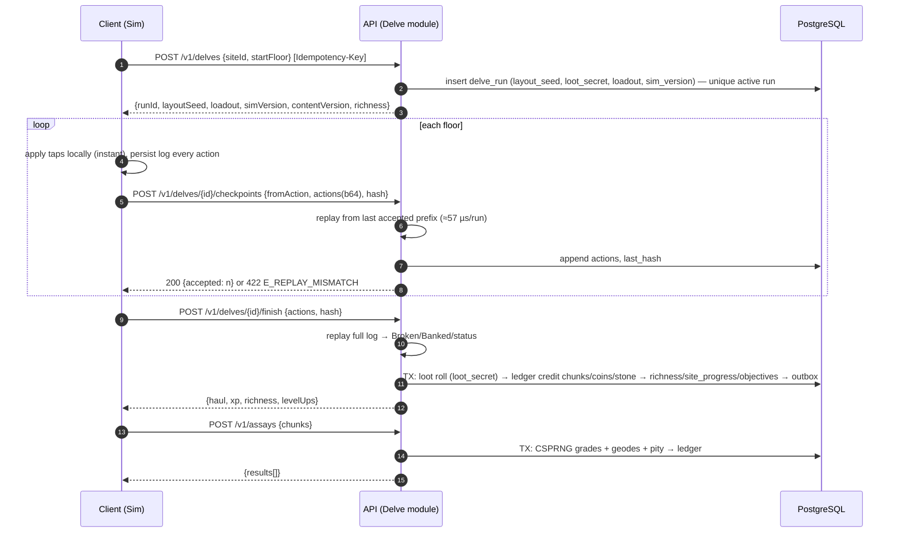

# 09 · Technical Architecture

**Guiding rule** (from [study/01 §8](../study/01-game-business-strategy-and-genre-options.md)): *keep the system simple, but make the important boundaries explicit so it can expand safely.* That means one deployable backend (a modular monolith), one relational database, server authority over everything valuable, and a shared deterministic simulation library.

## 9.1 System context

```mermaid
flowchart LR
    subgraph Device["Android device"]
        C[Unity client<br/>Deepforge.Sim + Contracts]
    end
    subgraph Google["Google services"]
        GP[Google Play Billing<br/>& Developer API]
        PI[Play Integrity API]
        PGS[Play Games Services v2]
        FCM[Firebase Cloud Messaging<br/>+ Crashlytics]
    end
    LINE[LINE Login]
    DR[drand beacon]
    subgraph GCP["Google Cloud · asia-east1 (Taiwan)"]
        LB[HTTPS Load Balancer<br/>+ Cloud Armor]
        API[Cloud Run: api<br/>.NET 10 modular monolith]
        WS[Cloud Run: realtime<br/>WebSocket fan-out]
        WK[Cloud Run: worker<br/>jobs, outbox, RTDN]
        ADM[Cloud Run: admin<br/>React + admin API, behind IAP]
        SQL[(Cloud SQL<br/>PostgreSQL 18 HA)]
        R[(Memorystore<br/>Valkey/Redis)]
        PS[[Pub/Sub]]
        GCS[(Cloud Storage<br/>content bundles)]
        CDN[Cloud CDN]
        BQ[(BigQuery)]
        SM[Secret Manager / KMS]
    end
    C -- HTTPS JSON --> LB --> API
    C -- WebSocket --> LB --> WS
    C -- bundles --> CDN --> GCS
    C --> GP & PI & PGS & LINE
    API --> SQL & R & SM
    API -- verify --> GP
    API -- decode verdict --> PI
    WS --> R
    WK --> SQL & R & PS & GP & DR
    GP -- RTDN --> PS --> WK
    WK -- outbox events --> PS --> BQ
    ADM --> SQL
    FCM <-- push --- WK
```

## 9.2 Technology stack

Pin exact versions at M0 and record them in `/infra/versions.md`.

| Layer | Choice | Version policy | Why |
|---|---|---|---|
| Client engine | Unity 6 LTS, URP 2D, IL2CPP, ARM64 | Latest LTS patch with 16 KB page support | ADR-011 |
| Shared libraries | `Deepforge.Sim`, `Deepforge.Contracts` | .NET Standard 2.1, C# 9 | Compile in both Unity and .NET ([13](13-simulation-core.md)) |
| Backend runtime | .NET 10 (LTS), ASP.NET Core minimal APIs | 10.0.x; patch monthly | ADR-012; LTS support through Nov 2028 |
| Data access | Npgsql + Dapper, hand-written SQL | — | Explicit transactions and SQL for the ledger hot path; no change-tracker surprises |
| Migrations | SQL files run by DbUp, expand/contract only | — | SQL-first, matches [`schema.sql`](appendices/reference/schema.sql) |
| Database | PostgreSQL 18 on Cloud SQL (Enterprise Plus, HA, PITR) | Major upgrade yearly | Transactions, partitioning, `uuidv7()` |
| Cache / leaderboards / rate limits | Memorystore for Valkey (Redis-compatible) | — | Sorted sets, token buckets, pub/sub fan-out |
| Messaging | Cloud Pub/Sub | — | Required for Google Play RTDN; outbox → BigQuery |
| Object storage / CDN | Cloud Storage + Cloud CDN | — | Immutable, hash-named content bundles |
| Analytics | BigQuery (Pub/Sub → BigQuery subscription) | — | ADR-019 |
| Secrets | Secret Manager; Cloud KMS for draw secrets and token keys | — | No secrets in repo or image |
| Admin UI | React 19 + TypeScript + Vite + TanStack Query, behind Identity-Aware Proxy | — | SSO + MFA from Google Workspace |
| IaC | Terraform 1.x | — | Reproducible; portable definitions |
| CI/CD | GitHub Actions; GameCI for Unity builds | — | [18](18-devops-and-operations.md) |
| Observability | OpenTelemetry SDK → Cloud Trace / Monitoring / Logging; Crashlytics (client) | — | NFR-OBS-001 |

## 9.3 Modules (bounded contexts)

One process, many modules. **Each module owns its tables.** Other modules use its C# interface, never its tables. Value moves only through the **Ledger** module.

| Module | Owns tables | Responsibilities | Depends on |
|---|---|---|---|
| Platform | `idempotency_record`, `job`, `outbox` | Idempotency, rate limiting, job queue, outbox publisher, clock | — |
| Identity | `account`, `account_identity`, `refresh_token` | Guest/PGS/LINE auth, JWT issue, token rotation, deletion | Platform |
| Players | `player`, `player_vocation`, `player_profession` | Profile, level, vocation switching, Power Score | Identity, Ledger |
| Ledger | `wallet`, `inventory_stack`, `item_instance`, `ledger_tx`, `ledger_line` | The **only** writer of balances and items; reconciliation | Platform |
| Delve | `delve_run`, `site_progress` | Start, checkpoint, finish, replay validation, settlement, richness | Sim, Ledger, Players, Progression |
| Assay | `assay_state` | Grades, geodes, pity | Ledger |
| Homestead | `building`, `production_job`, `crew_member`, `crew_roster`, `shift_state` | Buildings, smelter/forge queues, crew, Hasten | Ledger |
| Crafting | — (content-driven) | Merge, craft, enhance | Ledger, Homestead |
| Progression | `objective_progress`, `season`, `season_pass` | Objectives, Pass, XP | Ledger |
| Collections | `collection_entry`, `collection_set_claim` | Relics, dust, set bonuses | Ledger |
| Social | `friendship`, `gift_log`, `block_list`, `player_report`, `chat_message` | Friends, gifts, chat persistence, moderation | Ledger |
| Guilds | `guild*` | Membership, permissions, commissions, research, Deep Expedition, Colossus | Ledger, Delve |
| Leaderboards | `leaderboard_snapshot` (+ Redis) | Scores, around-me, snapshots | — |
| Draw | `draw`, `draw_ticket`, `draw_winner` | Tickets, commit/reveal, winners | Ledger, Mail |
| Store | `store_product`, `purchase`, `entitlement`, `purchase_limit_counter` | Catalog, verification, grant, acknowledge, revoke | Ledger, Identity |
| Mail | `mail` | Inbox, claims | Ledger |
| LiveOps | `realm`, `content_version`, `live_config`, `feature_flag`, `live_event`, `realm_milestone` | Content versions, config, events, eras, realm lifecycle | — |
| Admin | `admin_user`, `admin_approval`, `admin_audit` | Admin API, approvals, audit | All (through public interfaces) |

**Enforcement:**
- Each module is its own C# project (`Deepforge.Modules.Ledger`, …).
- An architecture test (NetArchTest) fails the build if module A references module B's internals or SQL.
- Cross-module side effects are domain events: written to the outbox inside the same transaction and handled by workers.

## 9.4 Repository layout (monorepo)

```
/client                Unity project (Assets/, Packages/, ProjectSettings/)
/shared
  /Deepforge.Sim        netstandard2.1; also a Unity package (package.json + asmdef)
  /Deepforge.Contracts  DTOs, error codes, enums shared by client and server
/server
  /src/Deepforge.Api           host: endpoints, middleware, DI
  /src/Deepforge.Worker        host: jobs, outbox, RTDN consumer
  /src/Deepforge.Modules.*     one project per module
  /tests/...                   unit, integration (Testcontainers), architecture, contract
/admin                 React app + admin API client
/content               source data (CSV/YAML) + JSON Schemas
/tools
  /Deepforge.ContentCompiler   'dfc' CLI ([15](15-content-pipeline-and-admin-tools.md))
  /economy                     economy_sim.py, unit_economics.py (moved from docs/appendices/scripts at M0)
/infra                 Terraform, Docker Compose for local dev
/docs                  this documentation
/study                 the original design study
```

The Unity client consumes `/shared/Deepforge.Sim` as a **local UPM package** (`"com.deepforge.sim": "file:../../shared/Deepforge.Sim"`). The server consumes it as a project reference. Both compile **the same source files**, and CI fails if the Unity compile of the shared code fails.

## 9.5 Request lifecycle

```
Client ──HTTPS──▶ Load Balancer (Cloud Armor: geo + rate rules, WAF)
          ▶ Auth middleware        validate JWT (ES256, kid rotation), load account/player ids
          ▶ Version middleware     X-Client-Version ≥ min? else 426 E_CLIENT_OUTDATED
          ▶ Rate limiter           Redis token bucket per (player, route-class)
          ▶ Idempotency middleware POST/PUT/DELETE require Idempotency-Key (UUID);
                                    replay stored response if (player, key) seen with same body hash
          ▶ Handler                one DB transaction: read → validate → mutate via Ledger → outbox
          ▶ Response               { data, serverTime, stateVersion }  or  RFC 9457 problem+json
```

## 9.6 Key flows

### 9.6.1 Delve (start → checkpoints → finish → assay)



### 9.6.2 Purchase

```mermaid
sequenceDiagram
    autonumber
    participant C as Client
    participant P as Google Play
    participant A as API (Store)
    participant DB as PostgreSQL
    participant W as Worker
    C->>A: GET /v1/store/catalog (limits checked, obfuscatedAccountId)
    C->>P: launchBillingFlow(productId, obfuscatedAccountId=HMAC(playerId))
    P-->>C: Purchase {purchaseToken, orderId}
    C->>A: POST /v1/purchases/google {productId, purchaseToken} [Idempotency-Key]
    A->>DB: insert purchase(state=received) ON CONFLICT(purchase_token) → return existing
    A->>P: purchases.products.get (or subscriptionsv2.get)
    P-->>A: purchaseState=PURCHASED, obfuscatedAccountId, orderId
    A->>DB: TX: verify account match → ledger grant → purchase.state=granted → outbox
    A-->>C: {granted: [...], balances}
    A->>P: consume (consumable) / acknowledge (non-consumable, sub)
    P-->>W: RTDN via Pub/Sub (renewals, cancellations, voided)
    W->>DB: reconcile; revoke on voided → aurum_debt
```

## 9.7 Core patterns (reference code)

### 9.7.1 Ledger: the only way to change value

```csharp
public sealed record AssetDelta(AssetKind Kind, string AssetId, long Delta);   // Kind: Currency | Stack
public sealed record ChangeSet(Guid OwnerId, string TxKind, string? RefType, string? RefId,
                               IReadOnlyList<AssetDelta> Deltas);

public sealed class LedgerService(IClock clock, IContentVersion content)
{
    // Must be called inside the caller's transaction (one command = one transaction).
    public async Task<Guid> ApplyAsync(NpgsqlConnection db, NpgsqlTransaction tx, ChangeSet cs, string actor = "player")
    {
        var txId = Guid.CreateVersion7();
        var now = clock.UtcNow;
        await db.ExecuteAsync("""
            INSERT INTO df.ledger_tx (tx_id, created_at, owner_kind, owner_id, kind, ref_type, ref_id, actor, content_version)
            VALUES (@txId, @now, 'p', @owner, @kind, @refType, @refId, @actor, @cv)
            """, new { txId, now, owner = cs.OwnerId, kind = cs.TxKind, refType = cs.RefType,
                       refId = cs.RefId, actor, cv = content.Live }, tx);

        short line = 0;
        // Deterministic order prevents deadlocks between concurrent transactions on the same rows.
        foreach (var d in cs.Deltas.Where(d => d.Delta != 0).OrderBy(d => d.Kind).ThenBy(d => d.AssetId, StringComparer.Ordinal))
        {
            long? balance = d.Kind switch
            {
                AssetKind.Currency when d.Delta > 0 => await db.ExecuteScalarAsync<long>("""
                    INSERT INTO df.wallet (player_id, currency, balance) VALUES (@o, @a, @d)
                    ON CONFLICT (player_id, currency) DO UPDATE SET balance = df.wallet.balance + EXCLUDED.balance
                    RETURNING balance
                    """, new { o = cs.OwnerId, a = d.AssetId, d = d.Delta }, tx),
                AssetKind.Currency => await db.ExecuteScalarAsync<long?>("""
                    UPDATE df.wallet SET balance = balance + @d
                    WHERE player_id = @o AND currency = @a AND balance >= -@d
                    RETURNING balance
                    """, new { o = cs.OwnerId, a = d.AssetId, d = d.Delta }, tx),
                AssetKind.Stack when d.Delta > 0 => await db.ExecuteScalarAsync<long>("""
                    INSERT INTO df.inventory_stack (player_id, item_id, qty) VALUES (@o, @a, @d)
                    ON CONFLICT (player_id, item_id) DO UPDATE SET qty = df.inventory_stack.qty + EXCLUDED.qty
                    RETURNING qty
                    """, new { o = cs.OwnerId, a = d.AssetId, d = d.Delta }, tx),
                _ => await db.ExecuteScalarAsync<long?>("""
                    UPDATE df.inventory_stack SET qty = qty + @d
                    WHERE player_id = @o AND item_id = @a AND qty >= -@d
                    RETURNING qty
                    """, new { o = cs.OwnerId, a = d.AssetId, d = d.Delta }, tx),
            };
            if (balance is null)
                throw new DomainException(ErrorCodes.InsufficientFunds, d.AssetId);   // caller rolls back

            await db.ExecuteAsync("""
                INSERT INTO df.ledger_line (tx_id, line_no, created_at, owner_kind, owner_id, asset_kind, asset_id, delta, balance_after)
                VALUES (@txId, @line, @now, 'p', @o, @kind, @a, @d, @bal)
                """, new { txId, line = ++line, now, o = cs.OwnerId,
                           kind = d.Kind == AssetKind.Currency ? "currency" : "stack",
                           a = d.AssetId, d = d.Delta, bal = balance }, tx);
        }
        await Outbox.EnqueueAsync(db, tx, "analytics.server", "economy.tx",
            new { txId, owner = cs.OwnerId, kind = cs.TxKind, deltas = cs.Deltas });
        return txId;
    }
}
```

Why this is race-safe without explicit locks:
- Each debit is a conditional `UPDATE … WHERE balance >= amount`, and the CHECK constraint backs it up (verified in [`schema_test.sql`](appendices/reference/schema_test.sql)).
- Two concurrent spends serialize on the row lock, and the second sees the updated balance.
- Ordering deltas by asset id avoids lock-order deadlocks.

### 9.7.2 Idempotency

- The client generates a **UUIDv7** `Idempotency-Key` per user intent and reuses it on retries.
- The server computes `request_hash = SHA-256(canonical JSON body)` and runs:
  ```sql
  INSERT INTO df.idempotency_record (owner_id, idem_key, route, request_hash, status_code, response)
  VALUES (@player, @key, @route, @hash, 0, '{}')
  ON CONFLICT (owner_id, idem_key) DO NOTHING;
  ```
  - **Inserted** → execute the handler, then update the record with the status and response, all in the **same transaction** as the business change.
  - **Conflict** with the same hash → return the stored response. If the status is still 0 (in flight), return `409 E_IN_PROGRESS`; the client backs off.
  - **Conflict** with a different hash → `422 E_IDEMPOTENCY_MISMATCH`.
- Records are purged after 7 days.

### 9.7.3 Lazy timers (no cron per player)

Production, building upgrades, crew output and richness are **computed on read** from stored timestamps (`done_at`, `last_collected_at`, `richness_updated_at`). No job runs for each player's timer. Jobs are only for global events: run expiry, draw close, season rollover, partition maintenance and purchase acknowledgement retries.

### 9.7.4 Job queue and outbox (PostgreSQL-native)

- **Jobs:** workers claim batches with `FOR UPDATE SKIP LOCKED` (query verified in `schema_test.sql`). Retries use exponential backoff; `dedupe_key` makes scheduling idempotent.
- **Outbox:** domain and analytics events are written in the business transaction. The publisher loop reads `published_at IS NULL ORDER BY id LIMIT 500`, publishes to Pub/Sub, and marks rows published. Delivery is at least once, and consumers are idempotent by event id.

### 9.7.5 Optimistic concurrency for aggregate state

Player-wide state that is not a balance (loadout, vocation, Trophy Hall layout) uses `player.state_version`:
```sql
UPDATE ... SET ..., state_version = state_version + 1 WHERE player_id = @p AND state_version = @expected
```
Zero rows means `409 E_CONFLICT_VERSION`, and the client refreshes the snapshot. This handles the same account on two devices.

## 9.8 Capacity plan

| Assumption | Value | Source |
|---|---|---|
| API calls per DAU per day | 200 (5 sessions × ~40) | Design estimate; validate in M3 |
| Peak-hour share of daily traffic | 12% (Taiwan evening peak) | Typical mobile curve; validate |
| Peak concurrent users (PCU) / DAU | 10% | Typical; validate |
| Delves per DAU per day | 8 | Archetype mix |
| Replay CPU | ~57 µs per run | Measured ([13 §13.10](13-simulation-core.md#1310-verification-results)) |
| Ledger lines per DAU per day | ~120 | Design estimate |

| DAU | Peak RPS | API instances (2 vCPU, ~4 ms CPU per request, 50% target utilization) | DB (Cloud SQL) | WebSockets at peak | Ledger growth per day |
|---|---|---|---|---|---|
| 10,000 | ~67 | 2 (minimum for HA) | 2 vCPU / 8 GB, HA | ~1,000 | ~0.3 GB |
| 50,000 | ~330 | 2–4 | 4 vCPU / 16 GB, HA + 1 read replica | ~5,000 | ~1.5 GB |
| 100,000 | ~670 | 4–6 | 8 vCPU / 32 GB, HA + 1 read replica | ~10,000 | ~3 GB |
| 300,000 | ~2,000 | 10–14 | 16–32 vCPU; consider moving the ledger to its own instance | ~30,000 | ~9 GB |

- **Ledger retention:**
  - Keep 90 days hot in monthly partitions.
  - Export older partitions to BigQuery and GCS (Parquet), then `DETACH` and `DROP`.
  - Keep a per-player monthly summary row so support can still answer "where did my coins go" for older periods.
- **When one primary is not enough** (> ~300,000 DAU):
  1. Move the ledger and analytics-heavy reads to a separate instance.
  2. Then shard by `realm_id` group. Realms are already a natural shard key, and no gameplay crosses realms except account identity.

**Cost estimate** (on-demand list prices, order of magnitude; check the GCP pricing calculator at M0):

| DAU | Estimated monthly cost |
|---|---|
| 10,000 | ≈ US$700–1,200 (Cloud SQL HA is the largest line) |
| 100,000 | ≈ US$4,000–8,000 |

This is consistent with the $0.09–0.30 per DAU-month assumed in [07 §7.12](07-monetization-and-business-model.md#712-business-model-and-unit-economics).

## 9.9 Environments

| Environment | Purpose | Data | Deploy |
|---|---|---|---|
| `local` | Developer machines | Docker Compose (PostgreSQL 18, Valkey, Pub/Sub emulator, fake Play verifier) | `make up` |
| `dev` | Integration of main branch | Synthetic | Every merge to `main` |
| `staging` | Release candidates, time-travel test realms, Play license testers | Synthetic plus anonymized snapshot (no PII) | Tagged release |
| `prod` | Players | Real | Manual approval; canary revision 10% → 100% |

Each environment is its own GCP project with Terraform workspaces. **There is never a network path from staging to the prod database.**

## 9.10 Failure modes and responses

| Failure | Effect | Mitigation |
|---|---|---|
| API instance crash | In-flight requests fail | Client retries with the same idempotency key; Cloud Run restarts |
| DB primary failover (HA) | 30–60 s of write errors | Client backoff and retry; idempotency prevents double effects |
| Redis loss | Leaderboards and rate limits reset | Rebuild leaderboards from PostgreSQL (scores derivable from snapshots + ledger); rate limiter fails open with a conservative in-process limit |
| Google Play API outage | Purchases cannot be verified | Purchases stay `received`; client shows "processing"; worker retries; RTDN backfills; never grant unverified |
| drand unavailable | Draw reveal delayed | Published fallback (Bitcoin block hash) after 30 min |
| Content bundle CDN miss | Client can't load new content | Bundles are immutable and hash-named; the client keeps the previous version until the new one verifies; the server refuses delves on mismatched hash |
| Exploit discovered | Economy damage | Feature-flag kill switch per module; ledger reversal tooling; runbook [18 §18.9](18-devops-and-operations.md#189-incident-runbooks) |
| Region outage (asia-east1) | Full outage | RTO 60 min target via cross-region replica in asia-northeast1 (promote) + Terraform; announced as an incident |
