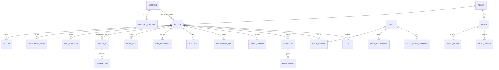

# 10 · Data Model

The authoritative DDL is [`appendices/reference/schema.sql`](appendices/reference/schema.sql) (PostgreSQL 18). Its invariants are verified by [`schema_test.sql`](appendices/reference/schema_test.sql) on a real PostgreSQL 18.6 instance. The tests cover:
1. overdraft impossible;
2. ledger append-only and partition-routed;
3. one active delve per player;
4. a single builder queue;
5. the four-eyes rule on approvals;
6. purchase tokens single-use;
7. job claiming with `SKIP LOCKED`;
8. UUIDv7 ordering;
9. one live content version;
10. the nightly ledger reconciliation query (§10.4) returns zero rows on consistent data and detects a balance changed outside the ledger.

The ledger write path in [09 §9.7.1](09-technical-architecture.md#971-ledger-the-only-way-to-change-value) has also been executed against that schema: credit, debit and overspend rejection, with ledger sums equal to balances.

## 10.1 Conventions

| Topic | Rule |
|---|---|
| Keys | `uuid` with `DEFAULT uuidv7()` (time-ordered: index-friendly, sortable). Realms use `smallint`; content ids use `text` |
| Content ids | Dotted lowercase: `ore.copper`, `ingot.bronze`, `comp.copper`, `gear.pick.bronze`, `site.tinreach`, `relic.wyrm_hoard.3`. Validated by the content compiler, **not** by foreign keys, because content is versioned outside the database |
| Status columns | `text` + `CHECK (... IN (...))`. Adding a value is an online `ALTER TABLE ... DROP/ADD CONSTRAINT ... NOT VALID` + `VALIDATE` |
| Time | Always `timestamptz`, stored in UTC. Realm-local dates (`realm_date`, `period_key`) are computed in the application from the realm's timezone |
| Money | Store prices as `price_micros bigint` + ISO currency; never floating point |
| Soft delete | Rows that matter for audit (items, accounts) get `deleted_tx` or a status, never `DELETE`; append-only tables block `UPDATE`/`DELETE` with a trigger |
| Schema | Everything lives in schema `df`; the application role has no DDL rights in production |

## 10.2 Core entity relationships



## 10.3 Table groups

| Group | Tables | Notes |
|---|---|---|
| Identity | `account`, `account_identity`, `refresh_token` | Guest secret stored as Argon2id hash; refresh tokens stored only as SHA-256; rotation families |
| Player | `player`, `player_vocation`, `player_profession` | `state_version` for optimistic concurrency; `name_norm` unique per realm |
| Value | `wallet`, `inventory_stack`, `item_instance` | `CHECK (balance >= 0)` / `qty >= 0`; partial unique index enforces one equipped item per slot |
| Ledger | `ledger_tx`, `ledger_line`, `ledger_checkpoint` | Monthly partitions; append-only triggers; checkpoints keep reconciliation exact after archiving |
| Platform | `idempotency_record`, `job`, `outbox` | 7-day idempotency purge; `SKIP LOCKED` job claim; outbox publisher |
| Homestead | `building`, `production_job`, `crew_member`, `crew_roster`, `shift_state`, `site_progress` | Lazy timers; unique "one builder" and "slot busy" partial indexes |
| Delve | `delve_run`, `assay_state` | `loot_secret` never leaves the server; one active run per player |
| Progress | `collection_entry`, `collection_set_claim`, `objective_progress`, `season`, `season_pass`, `mail` | Pass claims as bit strings (50 tiers fit in `bit varying(64)`) |
| Guilds | `guild`, `guild_member`, `guild_join_request`, `guild_wallet`, `guild_research`, `guild_commission`, `guild_event_instance`, `guild_event_attempt` | One guild per player (`UNIQUE player_id`); one leader per guild |
| Competition | `leaderboard_snapshot`, `draw`, `draw_ticket`, `draw_winner`, `claim`, `claim_holding`, `claim_assault` | Live boards in Redis; one prize per player per draw (PK) |
| Store | `store_product`, `purchase`, `entitlement`, `purchase_limit_counter` | `purchase_token` unique; partial index finds unacknowledged grants |
| Social | `friendship`, `gift_log`, `block_list`, `player_report`, `chat_message` | `friendship` stored once per pair (`player_lo < player_hi`); chat partitioned daily |
| LiveOps | `realm`, `content_version`, `live_config`, `feature_flag`, `live_event`, `realm_milestone` | One live content version (unique partial index); events need a second approver |
| Admin | `admin_user`, `admin_approval`, `admin_audit` | Roles validated against a fixed set; four-eyes CHECK; append-only audit |

## 10.4 The ledger in detail

**Every** change to currency, stack inventory or item instances is one `ledger_tx` with N `ledger_line` rows, written in the same transaction as the business change. Kinds (`ledger_tx.kind`):

| Kind | Examples |
|---|---|
| `delve.finish` | Chunk, coin and stone credit |
| `assay` | Fee debit; ore-unit credit; gems, relics, Starstone |
| `smelt.start` / `smelt.collect` | Ore debit at start; ingot credit at collect |
| `merge`, `craft`, `enhance` | Material debits; item creation (`asset_kind = instance`, delta +1) |
| `building.upgrade`, `hasten` | Cost debits |
| `crew.hire`, `crew.refresh` | Coin debits |
| `commission.fill` | Debit filler, credit requester (2 owners, so 2 transactions in one DB transaction) |
| `mail.claim`, `objective.claim`, `pass.claim`, `draw.prize` | Rewards |
| `purchase.grant`, `purchase.revoke` | Store |
| `admin.grant`, `admin.revoke`, `admin.reversal` | Audited admin actions (`actor = 'admin:<id>'`) |

**Nightly reconciliation (must return zero rows):**
```sql
WITH cp AS (            -- latest checkpoint per owner/asset (archive boundary)
  SELECT DISTINCT ON (owner_id, asset_id) owner_id, asset_id, as_of, balance
  FROM df.ledger_checkpoint WHERE asset_kind = 'currency'
  ORDER BY owner_id, asset_id, as_of DESC
), sums AS (
  SELECT l.owner_id, l.asset_id, sum(l.delta) AS delta
  FROM df.ledger_line l
  LEFT JOIN cp ON cp.owner_id = l.owner_id AND cp.asset_id = l.asset_id
  WHERE l.asset_kind = 'currency' AND (cp.as_of IS NULL OR l.created_at >= cp.as_of)
  GROUP BY 1, 2
)
SELECT w.player_id, w.currency, w.balance,
       coalesce(cp.balance, 0) + coalesce(s.delta, 0) AS expected
FROM df.wallet w
LEFT JOIN cp   ON cp.owner_id = w.player_id AND cp.asset_id = w.currency
LEFT JOIN sums s ON s.owner_id = w.player_id AND s.asset_id = w.currency
WHERE w.balance <> coalesce(cp.balance, 0) + coalesce(s.delta, 0);
```
The same query runs for `inventory_stack`. Any drift is a **Sev-2 incident** ([18 §18.9](18-devops-and-operations.md#189-incident-runbooks)): it means a code path bypassed the ledger.

**Support query: "where did my coins go?"**
```sql
SELECT t.created_at AT TIME ZONE 'Asia/Taipei' AS local_time, t.kind, t.ref_type, t.ref_id, t.actor,
       l.delta, l.balance_after
FROM df.ledger_line l JOIN df.ledger_tx t USING (tx_id, created_at)
WHERE l.owner_id = $1 AND l.asset_id = 'coins' AND l.created_at >= now() - interval '7 days'
ORDER BY l.created_at DESC, l.line_no
LIMIT 200;
```

## 10.5 Seeds and secrets in `delve_run`

| Column | Visibility | Purpose |
|---|---|---|
| `layout_seed` (u64 stored as a `bigint` bit pattern) | Sent to client | Floor generation and combat RNG. The client must know it in order to simulate |
| `loot_secret` (32 bytes) | **Server only** | Loot rounding, treasure caches, any reward randomness. Generated with `RandomNumberGenerator.GetBytes(32)` |
| `actions` (`bytea`) | Client-submitted, validated | Accepted action prefix; replayable forever for support (replay viewer in admin) |

Converting u64 ↔ bigint in C#: `long stored = unchecked((long)seed); ulong seed = unchecked((ulong)stored);`.

## 10.6 Redis (Valkey) keys

| Key pattern | Type | TTL | Purpose |
|---|---|---|---|
| `lb:{realm}:{board}:{period}` | ZSET (member = player or guild id, score = composite) | Period + 14 days | Live leaderboards. Ties are broken by encoding `score × 10^6 + (10^6 − turns)` |
| `rl:{player}:{class}` | String (token bucket via Lua) | 1 h | Rate limiting |
| `ws:route:{player}` | String (node id) | 2 min, refreshed | Which realtime node holds a player's socket |
| `ws:ch:guild:{id}` / `ws:ch:realm:{id}` | Pub/Sub channel | — | Chat and notification fan-out across realtime nodes |
| `cfg:live:{version}` | Hash | 10 min | Cached live config and flags |
| `boot:{player}` | String (JSON) | 30 s | Short-lived bootstrap cache, invalidated on write |
| `lock:{name}` | String (SET NX PX) | ≤ 30 s | Rare singleton jobs (draw close, season rollover) |

**Redis holds no system-of-record data.** If it is lost, leaderboards are rebuilt from snapshots plus ledger and run data ([09 §9.10](09-technical-architecture.md#910-failure-modes-and-responses)).

## 10.7 Data volumes and retention

| Data | Growth at 10k DAU | Hot retention | Then |
|---|---|---|---|
| `ledger_line` | ~1.2 M rows/day (~0.3 GB) | 90 days | Export to BigQuery + GCS Parquet → checkpoint → drop partition |
| `delve_run` (with action logs) | ~80 k rows/day (~25 MB) | 180 days | Archive to GCS (support replays on request) |
| `chat_message` | Varies | 30 days (guild) / 7 days (realm) | Drop partition |
| `idempotency_record` | ~1.5 M rows/day | 7 days | Delete in batches |
| Analytics events | Pub/Sub → BigQuery | 25 months in BigQuery (partitioned by day) | Aggregate tables kept |
| Accounts pending deletion | — | 30 days | Anonymize PII, keep the financial record (anonymized) as legally required |

## 10.8 Migrations policy

1. **Expand → migrate → contract.** Add a nullable column or new table, deploy code that writes both, backfill, switch reads, then drop the old structure in a later release. Never rename in place.
2. Every migration is a numbered SQL file (`V0042__add_trinket_slots.sql`) run by DbUp at deploy, inside a transaction where PostgreSQL allows it.
3. For large tables, run `CREATE INDEX CONCURRENTLY` in its own non-transactional migration.
4. Each migration's PR must say whether it is **online-safe**. Non-online-safe migrations need a maintenance window ([06 §6.8](06-live-operations-and-events.md#68-maintenance-and-compensation-policy)).
5. Monthly partitions are created **3 months ahead** by a scheduled job. An alert fires if fewer than 2 future partitions exist.
6. `schema_test.sql` runs in CI against a fresh PostgreSQL 18 container after all migrations.
