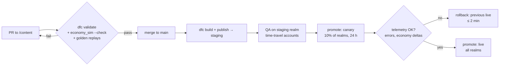

# 15 · Content Pipeline and Admin Tools

The study's operational requirement: the team must run the game **without editing the database by hand or deploying code for every event** ([study/01 §10](../study/01-game-business-strategy-and-genre-options.md), [study/05 §12E](../study/05-mining-rpg-concept-deepforge.md)). Two systems deliver it:

1. a **content pipeline** that turns designer-edited tables into validated, versioned, immutable bundles;
2. an **admin console** for operating the live game safely.

## 15.1 Content model

| Kind | Changes how often | Where it lives | Delivery |
|---|---|---|---|
| **Content**: items, recipes, sites, monsters, skills, buildings, relics, objectives, store products, odds tables, strings | Weekly to monthly | `/content` in git (CSV + YAML) | Compiled bundle (immutable, hash-named) via CDN; server loads it by version |
| **Live config**: multipliers, caps, thresholds | Ad hoc, minutes | `live_config` table | Bootstrap payload and server cache (10 min) |
| **Feature flags**: kill switches, rollouts | Ad hoc, seconds | `feature_flag` table | Bootstrap plus WebSocket `state.invalidate` |
| **Live events**: scheduled event instances | Weekly | `live_event` table (config validated by template schema) | Bootstrap `events[]` |

## 15.2 Source format

```
content/
  schema/                 JSON Schema per table (draft 2020-12)
  tables/
    items.csv             id, kind, tier, rarity, stack_max, tradeable, sell_price, icon, name_key
    recipes.csv           id, building, output_id, output_qty, inputs (JSON), coins, seconds, hh_min, era
    merges.csv            from_id, to_id, ratio, coin_fee
    sites.csv             id, era, min_level, min_hh, max_floors, stone_hp, ore_tiles, ore_mix (JSON), star_permille, ...
    monsters.csv          id, behavior, hp_pct, atk_pct, def_add, sites (JSON), params (JSON)
    skills.csv            id, vocation, unlock_level, cooldown, effect (JSON), ranks
    buildings.yaml        formulas (curves) → expanded to per-level tables at compile time
    relics.csv  sets.csv  objectives.csv  store_products.csv  odds.csv
  curves.yaml             shared formulas (XP, HH costs, enhancement) — single source with economy_sim
  loc/
    zh-TW/*.csv  en/*.csv key, text, context, max_length
```

**Why CSV and YAML in git:** designers edit them in a spreadsheet (Google Sheets → export, or directly in Excel or VS Code). Git gives history, diff, review and rollback for free.

**Example rows**
```csv
# recipes.csv
id,building,output_id,output_qty,inputs,coins,seconds,hh_min,era
craft.pick.copper,forge,gear.pick.copper,1,"{""comp.copper"":2,""mat.stone"":20}",300,600,2,1
craft.pick.bronze,forge,gear.pick.bronze,1,"{""asm.bronze"":3,""asm.copper"":2,""mat.quartz"":12}",3000,7200,8,2
alloy.bronze,smelter,ingot.bronze,1,"{""ingot.copper"":1,""ingot.tin"":1,""mat.coal"":0.5}",0,360,1,2
```
```yaml
# curves.yaml (mirrors docs/appendices/scripts/economy_sim.py)
xp_to_next:        { formula: "round(17 * L^1.7 / 5) * 5", levels: [1, 39] }
hall.coins:        { formula: "round(250 * 1.42^(L-2) / 10) * 10", levels: [2, 15] }
hall.stone:        { formula: "round(30 * (L-1)^1.5)", levels: [2, 15] }
enhance.fittings:  { formula: "ceil(2 * 1.35^n)", levels: [0, 9] }
```

## 15.3 The content compiler (`dfc`)

`/tools/Deepforge.ContentCompiler` is a .NET 10 console app, and it runs in CI on every PR that touches `/content`.

| Command | What it does |
|---|---|
| `dfc validate` | Schema checks, referential integrity, economy rules (below). Exit code ≠ 0 on any error |
| `dfc build --out dist/` | Expands curves, emits **canonical JSON** (sorted keys, no whitespace variance), `bundle.json.br`, and `manifest.json` with SHA-256 and version `YYYY.MM.DD-N` |
| `dfc diff <old> <new>` | Human-readable change report ("`craft.pick.bronze`: coins 3,000 → 2,800"), posted as a PR comment |
| `dfc sim-export` | Writes the parameters `economy_sim.py` consumes, so the simulation and the game can never drift (target: M2) |
| `dfc publish --env staging` | Uploads to GCS (`content/{version}/bundle.json.br`, immutable, `Cache-Control: public, max-age=31536000`) and registers the version through the admin API |

**Validation rules** (each is a named rule with tests):

| Rule | Check |
|---|---|
| `ids.unique` | No duplicate ids across tables |
| `refs.exist` | Every referenced id exists (recipe inputs, drop tables, site monsters, store grants) |
| `odds.sum` | Every odds table sums to exactly 1000‰ (assay grades, geode table, ore mixes) |
| `recipes.acyclic` | The recipe graph has no cycles |
| `merge.ratio` | Merge chains are 3→1 and fee tiers are monotonic |
| `economy.source_sink` | Every material has at least one source and one sink, unless flagged `terminal` (relics) |
| `economy.no_arbitrage` | Trading Post sell value of the outputs < sell value of the inputs plus coin cost, for every recipe and merge (no coin-printing loops) |
| `store.never_sell` | Store grants contain no item in the never-purchasable list (Starstone, relics, gems, tickets, rank points, gear above the current era) |
| `store.play_ids` | `store_products.csv` ids match the exported Play Console product list |
| `loc.complete` | Every player-facing id has `name_key` text in zh-TW and en, within `max_length` |
| `gating.monotonic` | Unlock levels and HH requirements never decrease with tier |
| `sim.sane` | For each site and each pick tier, the computed turns per floor > 0 and floors per delve sit in [1.5, 6] |
| `fairness.resim` | If any economy table changed, CI runs `economy_sim.py --check` with the exported parameters |

## 15.4 Live config and feature flags

**Live config keys** are declared in `content/schema/live_config.json`, each with a type, a default, **min/max bounds** and a category (`economy`, `ops`, `social`). The admin console refuses out-of-range values. Economy-category changes need a second approver.

**Feature flags:**

| Flag | Default | Purpose |
|---|---|---|
| `delve.enabled` | on | Kill switch (incident) |
| `assay.enabled` | on | Kill switch |
| `store.enabled` | on | Kill switch (e.g. a Play verification incident) |
| `commissions.enabled` | on | Kill switch (exploit) |
| `draw.enabled` | on | |
| `chat.realm.enabled` | on | Moderation emergency |
| `trade.contracts` | off | L+2 rollout (percentage of realms) |
| `arena.enabled` | off | L+1 rollout |
| `claims.enabled` | off | L+3 rollout |

Flag evaluation is server-side: `enabled && (rollout_percent == 100 || hash(realm_id or player_id, flag) % 100 < rollout_percent) && rules`. Clients receive their evaluated flags in bootstrap.

## 15.5 Publishing flow



- **Server switch:** a new live version is loaded by every instance via a Redis pub/sub notification. New delves start on the new version, and in-flight runs settle with the version they started with (the server keeps the last 3 versions in memory).
- **Client switch:** the next bootstrap reports a new hash; the client downloads, verifies and swaps.
- **Rollback:** promote the previous version again. Bundles are immutable, so nothing has to be rebuilt.

## 15.6 Admin console

**Stack:** React + TypeScript (Vite) talking to the admin API (`/admin/v1`), deployed as its own Cloud Run service behind Identity-Aware Proxy (Google Workspace SSO, enforced 2-step verification).

### Roles and permissions

| Capability | viewer | support | liveops | economy | finance | admin |
|---|---|---|---|---|---|---|
| View dashboards, players, runs | ✔ | ✔ | ✔ | ✔ | ✔ | ✔ |
| Add support notes; resend mail; small compensation (≤ 500 Aurum, ≤ 50k coins) | — | ✔ | — | ✔ | — | ✔ |
| Sanctions (mute, hide, suspend); account recovery | — | ✔ | — | — | — | ✔ |
| Large grants, Starstone/relic grants, ledger reversal | — | request | — | request/approve | — | approve |
| Live events (create; approve requires a different person) | — | — | ✔ | ✔ | — | ✔ |
| Live config: ops/social | — | — | ✔ | — | — | ✔ |
| Live config: economy | — | — | request | ✔ (second approver needed) | — | ✔ |
| Content promote / rollback | — | — | ✔ (approve) | ✔ | — | ✔ |
| Feature flags (kill switches) | — | — | ✔ | ✔ | — | ✔ |
| Purchases, refunds, financial reconciliation | — | view | — | — | ✔ | ✔ |
| Realm open / merge | — | — | request | — | — | approve |
| Draw void | — | — | request | — | — | approve |
| Admin users and roles | — | — | — | — | — | ✔ |

### Pages

| Page | Key functions |
|---|---|
| **Dashboard** | DAU, revenue today, error rate, queue depths, incidents, economy alerts |
| **Players** | Search by id, name or player code; profile; wallet and inventory; **ledger history**; purchases; runs with a **replay viewer** (step through actions, see the grid); reports; sanctions; notes |
| **Approvals** | Pending requests with diff view; approve or reject with a reason |
| **Grants & Mail** | Single and bulk grants (CSV upload of player ids), templated mail, preview |
| **Content** | Versions, `dfc diff` view, promote, canary %, rollback |
| **Live Events** | Calendar (realm time), create from template (schema-driven form), preview on staging, approve |
| **Config & Flags** | Typed editors with bounds, change history, scheduled changes |
| **Realms** | Status, population (weekly active), era milestones; open-realm wizard; merge wizard (plan → dry run → approve → execute) |
| **Draws** | Per realm: commit, tickets, beacon, winners; verify button; void (two approvers) |
| **Moderation** | Report queue (prioritized: `rmt`, `cheating`), chat context viewer, name reset, auto-mute review |
| **Economy** | Sources and sinks by currency and material (daily), inflation index, fairness ratios by spend band, resource concentration (Gini, top 1% share), Trading Post volume |
| **Finance** | Purchases, refunds, chargebacks; monthly reconciliation against Google Play earnings reports |
| **Audit** | Searchable audit log (read-only) |

## 15.7 Support workflows

| Case | Steps |
|---|---|
| **"I paid but got nothing"** | Search the player → Purchases. If the state is `received` or `verified` with no grant: press "Re-verify" (calls Google). If Google says PURCHASED, the grant runs. If no record exists: ask for the order id (GPA…), look it up in Play Console, and use "Attach purchase by token" (finance role) |
| **Lost guest account** | Requires an order id plus a device id match ([14 §14.3](14-security-and-anti-cheat.md#143-authentication-and-sessions)). Support role, audited. Otherwise decline politely and recommend linking |
| **Bug lost my run** | Open the run in the replay viewer. If the server rejected it wrongly (bug confirmed), use "Re-settle" (re-runs settlement from the stored log with a corrected engine) or compensate per policy ([06 §6.8](06-live-operations-and-events.md#68-maintenance-and-compensation-policy)) |
| **Ban appeal** | Check the risk-score breakdown and evidence (replays, behavior features). A second person decides. Document the outcome |
| **Exploit cleanup** | Identify affected transactions with an ad-hoc BigQuery query. Bulk ledger reversal through an approval. Mail an explanation. Never edit balances directly |

## 15.8 Financial reconciliation (monthly, finance role)

1. Google Play earnings and sales reports land in the Play-provided Cloud Storage bucket. A scheduled job imports them into BigQuery.
2. Join on `order_id` with `purchase`. Report:
   - orders in Play but missing in our DB (lost grants);
   - DB grants without a Play order (should be zero);
   - refunds in Play that were not revoked.
3. Revenue recognition: paid Aurum consumed in the month, plus entitlement periods (Charter and Pass recognized over their service period). The method is to be confirmed by the accountant.
