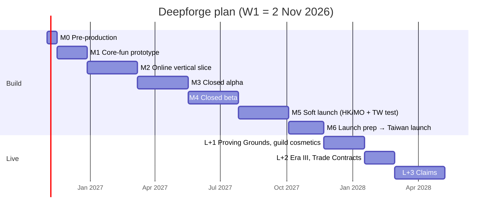

# 20 · Project Plan

This is a realistic plan for **four people**, starting **Monday 2 November 2026** (week W1). Dates are planning targets and depend on hiring the outsourced roles on time and on passing each gate. A gate that fails moves the dates; it does not shrink quality.

The plan is deliberately more conservative than [study/01 §12](../study/01-game-business-strategy-and-genre-options.md), which proposed 20 weeks to a limited launch. That timeline assumed a simple casual game; this design is a mining RPG with a live economy, guilds and original art. [study/05 §11](../study/05-mining-rpg-concept-deepforge.md) estimated 18–30 weeks to a meaningful closed test, and this plan reaches **closed alpha at W28**, within that range once art and content are included.

## 20.1 Team and ownership

| Person | Role | Owns (accountable) | Also does |
|---|---|---|---|
| P1 | **Client and gameplay engineer** (Unity lead) | Delve feel, client architecture, performance, Android build, store adapter | Simulation core (shared with P2) |
| P2 | **Backend and infrastructure engineer** | API, ledger, data, security, DevOps, on-call lead | Simulation server side, load tests |
| P3 | **Game and economy designer** (product owner) | Core loop, economy model, content tables, live ops, monetization, playtests, decision log | Community coordination, zh-TW copy review |
| P4 | **Full-stack engineer / technical artist** | Admin console, content compiler, analytics dashboards, UI implementation, art pipeline (atlases, Addressables) | Device lab, release management |

**Explicit ownership** (study/01 §11 requires named owners):

| Area | Owner |
|---|---|
| Core gameplay quality | P1 + P3 |
| Backend reliability | P2 |
| Economy balance | P3 |
| Product analytics | P4 (pipeline) + P3 (questions) |
| Release quality | P4 |

### Outsourced / contracted

| Need | When | Budget range (USD, indicative) |
|---|---|---|
| 2D art studio or freelancers: SD character, 3 Vocation kits, 3 tilesets, ~250 icons, Homestead buildings (×4 visual stages), UI skin, VFX | Art direction test W3–W6; production W9–W40 | 40,000–90,000 |
| Music (4–6 loops) and SFX library + custom mining SFX | W12–W30 | 5,000–15,000 |
| zh-TW copywriter / LQA (native Taiwanese) | W20 onward, part-time | 5,000–10,000 |
| Community manager (part-time, Taiwanese) | From W29 (closed beta) | 1,500–3,000 per month |
| Legal counsel (ToS, privacy, draw review, trademarks) | W20–W38 | 5,000–15,000 |
| External penetration test | W40–W42 | 4,000–10,000 |

## 20.2 Roadmap overview

| Milestone | Weeks | Calendar (approx.) | Theme |
|---|---|---|---|
| M0 Pre-production | W1–W2 | 2–13 Nov 2026 | Decisions, repo, CI, art direction brief |
| M1 Core-fun prototype | W3–W8 | 16 Nov – 25 Dec 2026 | Offline delve + assay + smelt/merge/craft in graybox |
| M2 Online vertical slice | W9–W18 | 28 Dec 2026 – 5 Mar 2027 | Backend foundations, server-authoritative loop, Homestead, 1 Vocation |
| M3 Closed alpha | W19–W28 | 8 Mar – 14 May 2027 | Return loop: Eras I–II, crew, collections, objectives, admin v1, analytics |
| M4 Closed beta | W29–W38 | 17 May – 23 Jul 2027 | Social and store: guilds, leaderboards, draw, IAP, Pass, Charter |
| M5 Soft launch | W39–W48 | 26 Jul – 1 Oct 2027 | Hong Kong/Macau open testing + capped Taiwan open test; iterate on retention |
| M6 Taiwan launch | W49–W55 | 4 Oct – ~16 Nov 2027 | Polish, marketing beats, scale tests; **launch about 10 weeks before Lunar New Year (26 Jan 2028)**, avoiding Ghost Month |
| L+1 | +8 weeks | ~Jan 2028 | Proving Grounds, guild cosmetics, LNY event |
| L+2 | +6 weeks | ~Feb–Mar 2028 (first realm day ~91) | Era III (Iron), Trade Contracts (if the readiness gate passes) |
| L+3 | +10 weeks | ~Q2 2028 | Claims (territory) |

## 20.3 Milestones and exit gates

Each milestone ends with a **gate review**: a 1-hour meeting with evidence, run by P3 with every person present. Outcomes are *Pass*, *Pass with actions*, or *Fail → repeat the milestone (max 1×) or pivot*.

### M0 · Pre-production (W1–W2)
**Deliverables:**
- this documentation reviewed;
- Proposed ADRs confirmed or changed;
- monorepo with CI skeleton;
- Unity project with `Deepforge.Sim`, `Deepforge.Contracts` and `Deepforge.Client.Core` as local packages (the reference code moved from `docs/appendices/reference/sim-core` and `client-core` to `/shared`; [21 §21.19](21-unity-client-detailed-design.md#2119-implementation-plan-client));
- Terraform for dev;
- art-direction brief and vendor shortlist;
- `economy_sim.py` moved to `/tools/economy` and wired into CI.

**Gate:**
- [ ] every Proposed ADR has an owner decision;
- [ ] CI builds and tests the simulation on server and Unity;
- [ ] vendor RFP sent.

### M1 · Core-fun prototype (W3–W8)
**Deliverables:**
- offline Unity build: Copperhollow floors 1–10 with Tunnel Wyrm;
- Engineer Vocation;
- tap and telegraphs;
- assay (local odds);
- smelt / merge / craft Copper Pick;
- graybox art plus placeholder SFX and haptics;
- device golden-replay test on ARM64;
- playtest with ≥ 20 people ([17 §17.8](17-quality-assurance-and-testing.md#178-playtesting-protocol)).

**Gate (the most important one):**
- [ ] ≥ 60% "another run now"; median ≥ 3 voluntary runs; satisfaction ≥ 4.0/5;
- [ ] determinism: client ARM64 hashes = server x64 hashes on all fixtures;
- [ ] frame time within budget on the reference mid device.

**If failed:** one more 4-week iteration on delve feel: grid size, tile HP, telegraph clarity, juice. If it fails twice, revisit ADR-004 (combat model) before building anything else.

### M2 · Online vertical slice (W9–W18)
**Deliverables:**
- Identity (guest + LINE + PGS);
- Ledger;
- delve start/checkpoint/finish with replay validation;
- assay server-side;
- Homestead (Hall, Smelter, Forge, Assay Office, Warehouse);
- content pipeline (`dfc` validate/build/publish);
- bootstrap;
- analytics outbox → BigQuery;
- staging environment;
- FTUE first pass.

**Gate:**
- [ ] tampered logs are rejected and honest ones accepted (automated suite);
- [ ] reconciliation drift = 0 after the integration suite;
- [ ] FTUE completes in < 15 min for 8 of 10 testers;
- [ ] p95 write < 300 ms at 200 RPS in staging.

### M3 · Closed alpha (W19–W28)
**Deliverables:**
- 3 Vocations;
- crew;
- Emberseam and Tinreach, with Era II gating;
- Bronze and Starstone gear;
- enhancement;
- collections and Trophy Hall;
- objectives (daily/weekly);
- mail;
- admin console v1 (players, ledger, grants with approvals, content, config/flags);
- dashboards (FTUE, retention, economy);
- art in production for Era I;
- closed alpha with ≥ 200 testers (Taiwan + Hong Kong), 3+ weeks.

**Gate:**
- [ ] D1 ≥ 35%, D7 ≥ 12% (directional; n ≥ 200);
- [ ] live pacing within ±20% of the model on 3 milestones;
- [ ] crash-free ≥ 99%;
- [ ] no S1 bugs open.

### M4 · Closed beta (W29–W38)
**Deliverables:**
- friends, gifts, visits;
- guilds (commissions, research, Deep Expedition, Colossus);
- chat and moderation;
- leaderboards and Hall of Fame;
- Motherlode Draw (commit-reveal + beacon);
- store (Aurum, Charter subscription + prepaid plan, Pass, Starter, crates), with purchase verification, RTDN and voided purchases;
- live-event templates;
- Deep Rift;
- account deletion;
- Play Integrity;
- store listing (zh-TW);
- legal docs v1;
- community manager onboarded;
- closed beta of 1,000–2,000 testers with real purchases (license testers plus a small set of real buyers).

**Gate:**
- [ ] purchase test matrix 100% pass ([17 §17.7](17-quality-assurance-and-testing.md#177-purchase-testing));
- [ ] draw verified by an external person with the Python script;
- [ ] D7 ≥ 13%;
- [ ] guild members' D7 ≥ non-guild D7;
- [ ] fairness ratio (live) ≤ 1.25;
- [ ] pen-test scheduled.

### M5 · Soft launch (W39–W48)
**Deliverables:**
- Google Play open testing in Hong Kong and Macau (no paid UA, or a small capped test budget to measure CPI);
- a **capped Taiwan open test** (≤ 5,000 players) from W44;
- weekly content and balance iteration;
- pen-test done and findings fixed;
- load test at 3× launch forecast;
- DR drill;
- **no wipe**: soft-launch progress carries over (announced).

**Gate** ([16 §16.8](16-analytics-and-kpis.md#168-soft-launch-decision-gates)), the "go" column:
- [ ] D1 ≥ 38%, D7 ≥ 13%, D30 ≥ 5%;
- [ ] conversion ≥ 2.5%; ARPDAU ≥ $0.12;
- [ ] crash-free ≥ 99.5%.

**Kill/pivot rule:** if D7 < 10% after two content iterations, stop scaling. Re-plan the core with the data, and don't spend on marketing ([07 §7.12](07-monetization-and-business-model.md#712-business-model-and-unit-economics)).

### M6 · Taiwan launch (W49–W55)
**Deliverables:**
- launch content polish;
- realm tw-001 (+ tw-002 ready);
- marketing beats: pre-registration on Google Play, creators, Bahamut and Facebook community, a press kit;
- featuring pitch to Google Play;
- launch event (`login_calendar` + `community_milestone`);
- on-call rota live;
- war room for launch week.

**Gate (go/no-go):**
- [ ] release checklist ([17 §17.10](17-quality-assurance-and-testing.md#1710-release-checklist-client--server));
- [ ] ops readiness: alerts, runbooks, budgets;
- [ ] Era III content ≥ 60% built (needed around day 91).

## 20.4 Work breakdown by milestone (person-weeks)

| Area | M1 | M2 | M3 | M4 | M5 | M6 | Total |
|---|---|---|---|---|---|---|---|
| Simulation and delve (P1, P2) | 8 | 4 | 4 | 2 | 2 | 1 | 21 |
| Client features and UI (P1, P4) | 3 | 10 | 12 | 12 | 6 | 5 | 48 |
| Backend modules (P2) | 1 | 9 | 7 | 9 | 4 | 2 | 32 |
| Infra / DevOps / security (P2) | 1 | 3 | 2 | 3 | 4 | 3 | 16 |
| Content, economy, live ops (P3) | 6 | 8 | 10 | 10 | 10 | 7 | 51 |
| Admin, tools, analytics (P4) | 1 | 5 | 8 | 6 | 3 | 2 | 25 |
| QA, playtests, release (all) | 2 | 2 | 3 | 4 | 6 | 4 | 21 |
| **Capacity** (4 × weeks × 0.85 focus factor) | 20 | 34 | 34 | 34 | 34 | 24 | 180 |
| **Planned** | 22 | 41 | 46 | 46 | 35 | 24 | 214 |

**Reading this honestly:** planned work exceeds capacity by about 19% overall, and M3/M4 are the most overloaded. Mitigations, in order:
1. outsource more art integration to the art vendor (deliver Unity-ready prefabs);
2. cut M4 scope candidates (below);
3. accept that M3/M4 may each take 2 extra weeks (shown as buffer in M6).

Do **not** solve this by skipping tests or economy work. Those are what make a live economy survivable.

**Scope cut list** (in this order if needed; each is a tagged feature that can move to L+1):
1. Workshop / trinkets (keep the Starstone Charm only).
2. Friend visits and Cheer (keep gifts).
3. Deep Rift (keep normal delves + Colossus).
4. Realm chat (keep guild chat).
5. Hall of Fame building (keep a list view).
6. Charter prepaid plan (keep auto-renew).

## 20.5 Budget summary (non-salary, indicative)

| Item | Low (USD) | High (USD) |
|---|---|---|
| Art | 40,000 | 90,000 |
| Audio | 5,000 | 15,000 |
| Localization / LQA | 5,000 | 10,000 |
| Legal | 5,000 | 15,000 |
| Pen test | 4,000 | 10,000 |
| Community manager (9 months) | 13,500 | 27,000 |
| Infrastructure pre-launch (12 months, dev/staging/prod) | 4,000 | 9,000 |
| Tools and licences (Unity tier per revenue threshold, Google Workspace, monitoring) | 3,000 | 10,000 |
| Devices (test phones) | 2,000 | 4,000 |
| Launch marketing (creators, community events, small UA test) | 20,000 | 120,000 |
| Contingency (15%) | 15,000 | 46,000 |
| **Total** | **≈ 116,500** | **≈ 356,000** |

This sits in or above the study's highest budget band ([study/01 Q5](../study/01-game-business-strategy-and-genre-options.md)). The team never stated its budget. If it is lower:
- reduce art scope (fewer building stages, shared kit silhouettes);
- shift marketing toward community and creators;
- consider a publishing partner in Taiwan for M6.

## 20.6 Ways of working

| Practice | Rule |
|---|---|
| Cadence | 2-week sprints; Monday planning (30 min); daily async stand-up in chat; Friday demo (build on devices) |
| Board | One board, columns Backlog → Ready → In progress → Review → Done; WIP limit of 2 per person |
| Definition of Ready | Linked requirement id ([08](08-requirements-specification.md)), acceptance criteria, design or mock linked, content ids defined |
| Definition of Done | Code + tests + docs updated + content validated + feature flag (if risky) + telemetry events + reviewed + deployed to staging |
| Branching | Trunk-based; short-lived branches; squash merge; release tags `server-vX.Y.Z`, `client-vX.Y.Z`, content `YYYY.MM.DD-N` |
| Decisions | Any decision that changes a pillar, monetization rule, platform or core architecture gets a decision-log entry ([00](00-decision-log.md)) |
| Docs | These docs live with the code. A PR that changes behavior updates the relevant doc in the same PR |
| Retros | Every milestone gate, plus after every incident |

## 20.7 Top risks

The full register is in [Appendix F](appendices/F-risk-register.md).

| Risk | Likelihood | Impact | Mitigation | Owner |
|---|---|---|---|---|
| Core delve not fun enough | Medium | Critical | M1 gate with real players; iterate before building the meta | P3 |
| Scope exceeds capacity (shown in §20.4) | High | High | Cut list; outsource integration; buffers; no feature creep without the decision log | P3 |
| Retention below gates | Medium | Critical | FTUE focus; catch-up systems; guild early; data-driven iteration | P3 |
| Paid UA too expensive (break-even CPI ~ $1.60) | High | High | Community-led growth plan; featuring pitch; realm-opening beats | P3 |
| Art vendor delay or quality | Medium | High | Art test before contract; milestone payments; style guide; second vendor shortlisted | P4 |
| Determinism bug on device | Low | High | Device golden replays from M1; no floats; analyzer | P1 |
| Economy exploit at launch | Medium | High | Ledger, reconciliation, kill switches, abuse tests, model checks | P2 |
| Content runway: whales finish Era II by ~day 77 | High | Medium | Proving Grounds in L+1; Deep Rift; collections; Era III ≥ 60% built at launch | P3 |
| Single point of failure in a 4-person team | Medium | High | Docs, pairing on the sim and ledger, on-call rotation, runbooks | All |
