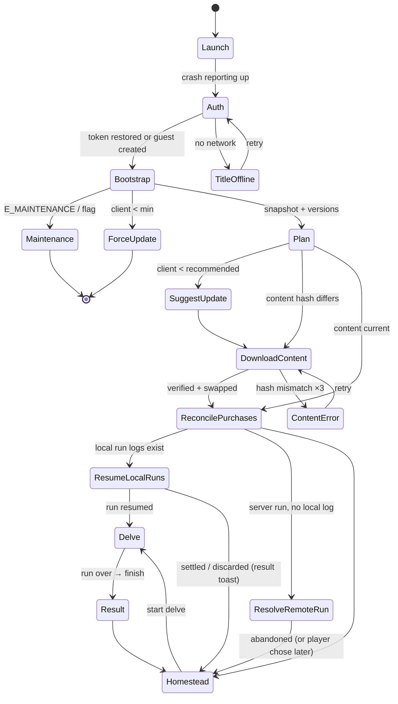
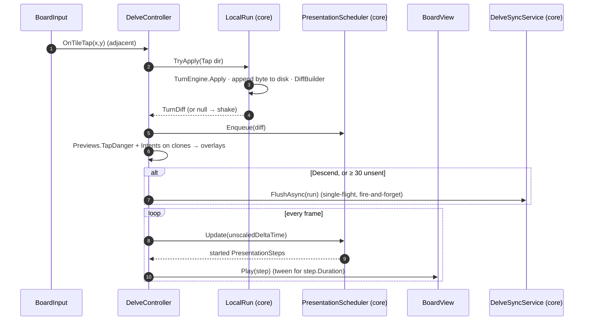
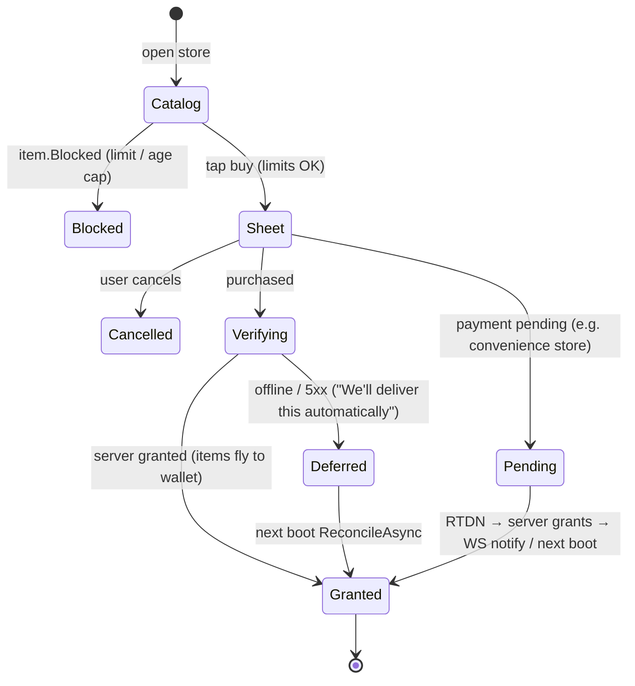

# 21 · Unity Client Detailed Design

This document turns the client architecture in [12](12-client-architecture.md) into a buildable design. It covers flows, scenes, screens, the delve client, presentation, networking, persistence, purchases, composition, asset specifications and a test plan.

**Verification status:**

| Part | Status |
|---|---|
| **Client core** (engine-agnostic C#: networking, delve runtime and sync, previews, travel, presentation timing, content cache, purchases, boot planning, formatting) | **Implemented and tested**: [`appendices/reference/client-core`](appendices/reference/client-core/), **45/45 tests** ([§21.18](#2118-verification-results)) |
| **Unity layer** (MonoBehaviours, UnityWebRequest transport, VContainer composition) | **Specified here with illustrative code. Not compiled:** no Unity Editor in this environment. It is deliberately thin so most risk sits in the tested core |

Writing and testing the core found **two protocol bugs** in the earlier design. Both are now fixed in the code and in [13 §13.7](13-simulation-core.md#137-replay-protocol):
1. Out-of-order checkpoints could get an **honest run rejected**.
2. `ConfigureAwait(false)` would have let network continuations **race the main thread** under Unity.

---

## 21.1 Design goals

| # | Goal | How the design meets it | Verified by |
|---|---|---|---|
| G1 | Taps feel instant | Simulation first, animation second; the network is never on the tap path | Per-tap core work 13.7 µs (desktop) |
| G2 | No lost progress | Every action is flushed to disk; resume after a kill; late finish after expiry | `Survives_process_death…`, `Killed_mid_run…`, `Expired_run…` |
| G3 | No double rewards | One idempotency key per intent; token-derived keys for purchases; server dedupe | `Retries_after_lost_request…`, `Grants_once…` |
| G4 | Honest players are never punished by the network | Single-flight checkpoints; server stale-duplicate rule; convergence under 20/20/10% faults | `Honest_runs_converge…` ×5, `Flushes_are_single_flight`, `A_late_stale_checkpoint…` |
| G5 | Fair, readable tactics | Exact intent and danger previews; lethal warning; travel never walks into damage | `Tap_danger_is_exact`, `Intents_match…`, `Travel_…never_walks_into_damage` |
| G6 | Testable without the Editor | Engine-agnostic core behind 6 interfaces | 45 tests in ~2 s |
| G7 | Safe threading under Unity | Single-threaded contract, no `ConfigureAwait(false)` | `Client_core_never_leaves_the_main_thread` (mutation-checked) |

## 21.2 Two-layer client

```mermaid
flowchart TB
    subgraph Unity["Unity layer (thin)"]
        V[Views: BoardView, HUD, screens]
        C[Controllers: BootController, DelveController, StoreController]
        P[Platform adapters: UnityWebRequestTransport, PlayBillingStoreAdapter,<br/>KeystoreAuthSession, UnityMonotonicClock, Haptics, Push]
        R[Composition root: GameLifetimeScope (VContainer)]
    end
    subgraph Core["Client core (engine-agnostic, .NET Standard 2.1 / C# 9)"]
        API[ApiClient · ServerClock]
        ST[SnapshotStore]
        DL[LocalRun · DelveSyncService · Previews · Travel]
        PS[PresentationScheduler]
        CC[ContentCache · BootPlanner · PurchaseFlow · NumberFormatter]
    end
    SIM[Deepforge.Sim]
    CON[Deepforge.Contracts]
    V --> C --> Core
    P -. implements IHttpTransport / IStoreAdapter / IAuthSession / IMonotonicClock .-> Core
    R --> C
    DL --> SIM
    API --> CON
```

| Component | Layer | Responsibility | Reference file |
|---|---|---|---|
| `ApiClient` | Core | HTTP conventions, retries, idempotency, token refresh, error mapping | [`Net/ApiClient.cs`](appendices/reference/client-core/Deepforge.Client.Core/Net/ApiClient.cs) |
| `IHttpTransport`, `HttpClientTransport`, `UuidV7` | Core | Network seam; ids | [`Net/Transport.cs`](appendices/reference/client-core/Deepforge.Client.Core/Net/Transport.cs) |
| `ServerClock` | Core | Server-synced time (median of 5) | [`Time/ServerClock.cs`](appendices/reference/client-core/Deepforge.Client.Core/Time/ServerClock.cs) |
| `SnapshotStore` | Core | Versioned read model for views | [`State/SnapshotStore.cs`](appendices/reference/client-core/Deepforge.Client.Core/State/SnapshotStore.cs) |
| `LocalRun`, `FileRunLogStore` | Core | Local rules + durable log | [`Delve/LocalRun.cs`](appendices/reference/client-core/Deepforge.Client.Core/Delve/LocalRun.cs), [`Delve/RunLogStore.cs`](appendices/reference/client-core/Deepforge.Client.Core/Delve/RunLogStore.cs) |
| `TurnDiff`, `DiffBuilder` | Core | What each action changed, in presentation order | [`Delve/TurnDiff.cs`](appendices/reference/client-core/Deepforge.Client.Core/Delve/TurnDiff.cs) |
| `Previews` | Core | Intents, tap danger, wait danger, taps-to-break | [`Delve/Previews.cs`](appendices/reference/client-core/Deepforge.Client.Core/Delve/Previews.cs) |
| `Travel` | Core | Tap-to-travel planning and safe execution | [`Delve/Travel.cs`](appendices/reference/client-core/Deepforge.Client.Core/Delve/Travel.cs) |
| `DelveSyncService` | Core | Start, single-flight checkpoints, finish, resume, abandon-remote | [`Delve/DelveSyncService.cs`](appendices/reference/client-core/Deepforge.Client.Core/Delve/DelveSyncService.cs) |
| `PresentationScheduler` | Core | Diff → timed steps; backlog compression | [`Presentation/PresentationScheduler.cs`](appendices/reference/client-core/Deepforge.Client.Core/Presentation/PresentationScheduler.cs) |
| `ContentCache` | Core | Verified bundle install, atomic pointer, prune | [`Content/ContentCache.cs`](appendices/reference/client-core/Deepforge.Client.Core/Content/ContentCache.cs) |
| `PurchaseFlow`, `IStoreAdapter` | Core | Limits → store → verify → reconcile | [`Store/PurchaseFlow.cs`](appendices/reference/client-core/Deepforge.Client.Core/Store/PurchaseFlow.cs) |
| `BootPlanner` | Core | Pure boot decision | [`Boot/BootPlanner.cs`](appendices/reference/client-core/Deepforge.Client.Core/Boot/BootPlanner.cs) |
| `NumberFormatter` | Core | 萬/億 and K/M/B; durations | [`Format/NumberFormatter.cs`](appendices/reference/client-core/Deepforge.Client.Core/Format/NumberFormatter.cs) |
| `UnityWebRequestTransport`, `UnityMonotonicClock` | Unity | Platform network and time | [§21.8](#218-networking-in-unity) |
| `DelveController`, `BoardView`, `BoardInput`, `DelveHud` | Unity | Delve scene | [§21.6](#216-delve-client) |
| `BootController`, `GameLifetimeScope` | Unity | Boot and composition | [§21.3](#213-application-flow), [§21.11](#2111-composition-root) |

### Threading contract

The client core is **single-threaded by contract**:
1. Call it from Unity's main thread.
2. It never uses `ConfigureAwait(false)`, so every continuation resumes on the caller's `SynchronizationContext` (Unity's main thread).
3. Consequences:
   - `UnityWebRequest`, which must be created on the main thread, is always legal;
   - `LocalRun`, `SnapshotStore` and the stores need no locks;
   - input handling and network completions interleave but never run in parallel.

**Proof:** `ThreadingContractTests` runs a full delve with a hostile network under a single-threaded synchronization context, using a transport and delays that deliberately complete on thread-pool threads. It asserts that every transport call and every continuation stays on the "main" thread. Re-inserting one `ConfigureAwait(false)` after the transport call makes the test fail.

**Rule for Unity-layer code:** never block on core tasks (`.Result`, `.Wait()`), because that deadlocks the main thread. Use `await`, or `Forget()` with error logging.

## 21.3 Application flow



`BootPlanner.Plan(BootInputs)` produces the ordered steps, and `BootController` executes them. Every branch is unit-tested (`Plans_every_branch`).

| State | Shown to the player | Error handling |
|---|---|---|
| Auth | Splash + progress | Network down → offline title screen with retry; `E_AUTH_REVOKED` → clear tokens, fresh guest or sign-in choice |
| Bootstrap | "Connecting…" | Up to 4 retries with backoff (ApiClient); then the offline title |
| Maintenance | Localized screen with end time in realm time; community links | Polls every 60 s |
| ForceUpdate | Store prompt (In-App Update API "immediate" flow) | Blocks |
| DownloadContent | Progress bar (MB) | Hash mismatch → retry ×3 → error screen; the previous version stays valid |
| ReconcilePurchases | Silent; a toast if something was granted ("Your purchase has been delivered") | Offline → retried next boot |
| ResumeLocalRuns | "Resuming your delve…" | Corrupt log → discarded silently (the server settles its prefix) |
| ResolveRemoteRun | Dialog: "A delve is still open on another device. End it here? Progress up to its last checkpoint counts as fainted." | "Later" keeps it, and delve start is disabled until resolved |

### BootController (Unity layer, illustrative, not compiled)

```csharp
public sealed class BootController : MonoBehaviour
{
    [Inject] private ApiClient _api; [Inject] private ContentCache _content; [Inject] private PurchaseFlow _purchases;
    [Inject] private DelveSyncService _sync; [Inject] private IRunLogStore _runs; [Inject] private SceneFlow _scenes;
    [Inject] private SnapshotStore _store; [Inject] private ContentDb _contentDb;

    private async void Start()   // async void is acceptable for a Unity entry point; everything inside is caught
    {
        try
        {
            var boot = await _api.GetAsync<BootstrapResponse>("/v1/bootstrap", destroyCancellationToken);
            BootstrapApplier.Apply(_store, boot);                                     // slices → SnapshotStore
            var plan = BootPlanner.Plan(new BootInputs
            {
                ClientVersion = Application.version, MinVersion = boot.Client.Min, RecommendedVersion = boot.Client.Recommended,
                LocalContentVersion = _content.LiveVersion, LiveContentVersion = boot.Content.Version,
                LocalRunIds = _runs.ListRuns(), ServerActiveRunId = boot.ActiveRun?.RunId,
            });
            foreach (var step in plan)
            {
                switch (step)
                {
                    case BootStep.ForceUpdate: _scenes.ShowForceUpdate(); return;
                    case BootStep.SuggestUpdate: _scenes.ToastUpdateAvailable(); break;
                    case BootStep.DownloadContent: await ContentDownloader.InstallAsync(_content, boot.Content, destroyCancellationToken); break;
                    case BootStep.ReconcilePurchases: _purchases.ReconcileAsync(destroyCancellationToken).Forget(); break;
                    case BootStep.ResumeLocalRuns:
                        foreach (var id in _runs.ListRuns())
                        {
                            var r = await _sync.ResumeAsync(id, _contentDb.Site, _runs, destroyCancellationToken);
                            if (r.Kind == ResumeKind.Resumed) { _scenes.EnterDelve(r.Run); return; }
                            if (r.Result != null) _scenes.QueueRunResultToast(r.Result);
                        }
                        break;
                    case BootStep.ResolveRemoteRun: await _scenes.AskResolveRemoteRunAsync(boot.ActiveRun); break;
                    case BootStep.EnterHomestead: _scenes.EnterHomestead(); return;
                }
            }
        }
        catch (ApiException e) when (e.Code == ErrorCodes.Maintenance) { _scenes.ShowMaintenance(e.Problem.Detail); }
        catch (TransportException) { _scenes.ShowOfflineTitle(); }
    }
}
```

## 21.4 Scenes, prefabs and UI layering

**Scene hierarchy** (Homestead shown; other scenes follow the same pattern):
```
Homestead (scene)
├── [Systems]            GameLifetimeScope child scope, SceneFlow, AudioDirector, HapticsService
├── World                orthographic camera "WorldCam"; parallax hillside; Building_* prefabs (tappable)
│   ├── Buildings/       Building_Hall, Building_Smelter, … (state-driven visuals: 4 stages by level)
│   └── CrewStrip        pooled CrewAvatar ×8
├── UIRoot (Canvas, Screen Space - Camera, sort 100)  SafeAreaFitter
│   ├── TopBar           CurrencyChip ×3 (coins, aurum, guild marks), ProfileButton, MailButton (badge)
│   ├── BottomNav        Homestead · Delve · Forge · Guild · More
│   ├── PanelHost        ScreenRouter stack (Addressable panels)
│   └── ToastHost
└── OverlayRoot (Canvas, sort 1000)   Modal host, Loading veil, Maintenance/Offline banners
```

| Layer | Canvas / sorting | Contents | Blocks input below |
|---|---|---|---|
| World | WorldCam, sorting layers | Homestead or delve board | — |
| HUD | 100 | Top bar, bottom nav, delve HUD | No |
| Panels | 200 | Forge, Assay, Guild, Store… | Yes (dims world) |
| Modals | 500 | Confirmations, purchase sheet wrapper, resolve-run dialog | Yes |
| Toasts | 800 | Non-blocking notices | No |
| System | 1000 | Offline banner, maintenance, loading veil | Varies |

**Prefab conventions:**
- Names: `Panel_Forge`, `Widget_CurrencyChip`, `Tile_Base`, `Mon_CaveRat`, `Fx_TileBreak`.
- Each panel has a `PanelView` component with `Show(args)` / `Hide()` and binds to `SnapshotStore` slices in `OnEnable`, unbinding in `OnDisable`.
- Each panel is its own Addressable entry, so first-open loads on demand.

## 21.5 Screen specifications

**Reference canvas:** 1080 × 2340 portrait (9:19.5), scale-with-screen-size, match = 0 (width).

| Element | Spec |
|---|---|
| Safe area | Applied at the UI root |
| Side gutter | 32 px |
| Thumb zone | The bottom 40% holds every frequent action |
| Touch targets | ≥ 48 dp (≈ 132 px at 2.75×) |
| Body text | 32 px |
| Labels | 26 px |

Wireframes use English labels so the ASCII art stays aligned; the zh-TW copy comes from the string tables.

### 21.5.1 Homestead

```
+------------------------------------------+
| [Avatar Lv14]   Coins 4,210  Aurum 130  M|  top bar: chips open shop/details; M = mail (badge)
|------------------------------------------|
|        ~ hillside camp, parallax ~        |
|   [Hall 6]      [Smelter 5]   [Forge 5]   |  buildings: level badge, progress ring when busy,
|      (5h 12m)      ( 70 >)                |  "ready" bounce when output can be collected
|   [Assay]       [Warehouse]   [Trophy]    |
|  Crew: o o o o  [Collect 38 ore]          |  crew strip; collect-all button with total
|------------------------------------------|
|  Daily 3/5  [====----]   Draw: 7 tickets  |  objectives + draw summary (tap to open)
|------------------------------------------|
|        [    DELVE  (Copperhollow)   ]     |  primary CTA, last site + richness
|------------------------------------------|
| Home  |  Delve  |  Forge  |  Guild | More |  bottom nav
+------------------------------------------+
```

| Interaction | Result |
|---|---|
| Tap a building | Opens its panel. If output is ready, the first tap collects (with a "+70 ingots" fly-up) |
| Tap "Collect" | `POST /crew/collect`; the crew strip animates; inventory slice updates |
| Tap DELVE | Site select (§21.5.2). Disabled with the reason if a remote run is unresolved |

| State | Behavior |
|---|---|
| Loading | Skeleton chips |
| Offline | Banner "Offline: changes disabled"; all write buttons disabled; cached snapshot shown |
| Builder busy | Hall shows a timer computed with `ServerClock` |

### 21.5.2 Site select

```
+------------------------------------------+
| < Back            Choose a mine           |
|------------------------------------------|
| [Copperhollow]  Era I   Richness 64% ■■■□ |  richness bar; boss icon if first clear pending
|   Start at: (1) (5) (10*)     Boss: Wyrm  |  waystone chips; * = deepest
| [Emberseam]     Era I   Richness 100%     |
|   Start at: (1) (5)                       |
| [Tinreach]  LOCKED  needs Lv20 · HH8 · Era II  |
|------------------------------------------|
| Loadout: Pick Cu+3 (MPW15) Lamp Cu (220)  |  tap to change gear / skills (2 of 3)
| Skills: [Blast] [Turret]  (Repair)        |
|           [   START DELVE   ]             |
+------------------------------------------+
```

- START calls `DelveSyncService.StartAsync` → `LocalRun.Start` → `Delve` scene. `E_RUN_ACTIVE` leads to the resume or resolve flow.

### 21.5.3 Delve HUD

```
+------------------------------------------+
| ||  B3 Copperhollow        Haul 23  Geo 1 |  pause, floor, haul chunks (unbanked in amber)
| HP [########--] 48/60   OIL [######] 131  |  oil bar pulses < 20%; HP pulses < 30%
|------------------------------------------|
|   .    .    @    .    :    :    #        |  @ delver   . open   : dirt   # stone
|   :    :   (:)   :    #    #    #        |  ( ) = tile under finger (hold to repeat)
|   #   <C3>  :    :   r->   :    #        |  <C3> copper vein, 3 taps   r-> rat will move right
|   #    #    :    X    :    :    #        |  X = bedrock
|   #    #   [!]   #    #    #    #        |  [!] red edge: tapping that way costs HP (lethal = skull)
|   #    #    #    #    #   [v]   #        |  [v] stairs (waystone floors: gold frame)
|------------------------------------------|
|  [ BLAST 3 ]  [ TURRET ]   [ DESCEND v ]  |  skills show cooldown turns; contextual descend/surface
+------------------------------------------+
```

- The board is 7×9 tiles. HUD and skills sit in the bottom thumb zone.
- The status line shows "syncing" (a small cloud icon) while checkpoints are unsent and offline.

### 21.5.4 Delve result

```
+------------------------------------------+
|            SURFACED  B5 -> Surface        |  or FAINTED (amber) / ABANDONED
|------------------------------------------|
| Floors 3   Turns 211   Monsters 4         |
| Copper chunks   23   (22 tiles x 90% x +6%)|  breakdown from server: tiles, richness, mining bonus
| Coal 4   Quartz 1   Stone 28   Coins 39   |
| XP +75   Mining +23                       |
| Richness now 80%  (recovers +5%/h)        |
|------------------------------------------|
|  [ ASSAY NOW ]        [ DELVE AGAIN ]     |
+------------------------------------------+
```

- **The client never predicts loot.** The screen shows "Settling…" until `FinishResponse` arrives. If offline, it shows "Saved. We'll settle this run when you're back online", and the run is resumed at the next boot.

### 21.5.5 Assay

```
+------------------------------------------+
| < Back        Assay Office      [Odds]    |
|------------------------------------------|
|  Copper chunks x22        Fee 22 coins    |
|  [ C ][ C ][ B ][ C ][ A ][ C ][ C ] ...  |  chunks flip in sequence (skip after first second)
|  Grades: C13 B7 A2 S0  -> 24 ore units    |
|  * GEODE!  -> Relic: Fang Necklace (new)  |  geode reveal: shake, light burst, card
|------------------------------------------|
|  Prospector's Instinct [#####-----] 131/250 |  pity meter, always visible
|           [ ASSAY ALL ]                   |
+------------------------------------------+
```

- [Odds] lists every table for the live content version.
- Auto-assay (Charter) runs the same flow with a compressed animation.
- Reduced-flash mode replaces the burst with a glow.

### 21.5.6 Forge (merge)

```
+------------------------------------------+
| < Back   Forge   [Merge] [Craft] [Enhance]|
|------------------------------------------|
|  Ingot Cu 61  ->  Fitting  (3 : 1, 5c)    |
|  Fitting  4   ->  Component (3 : 1, 15c)  |  each row: tap = 1 merge; hold = repeat
|  Component 3  ->  Assembly (3 : 1, 60c)   |
|------------------------------------------|
|  Auto-merge up to: [Component v]          |
|  Result: 6 Components, cost 180 coins     |  preview computed before confirming
|          [  AUTO-MERGE  ]                 |
+------------------------------------------+
```

### 21.5.7 Store

```
+------------------------------------------+
| < Back   Store     [Aurum][Pass][Bundles][Cosmetics] |
|------------------------------------------|
|  Prospector's Charter   US$4.99/mo        |  benefits listed in full; "Cancel anytime in Google Play"
|   30 Aurum/day (stacks 7 days) +1 smelter |
|   +4h offline · auto-assay · monthly skin |
|          [ SUBSCRIBE ]  [ 30-day pass ]   |
|------------------------------------------|
|  Supply Crate  US$4.99   2 left this week |  fixed contents shown; limit shown; disabled at 0
|   2 Components + 500 coins                |
|------------------------------------------|
|  Aurum 330 (+10%)  US$4.99  FIRST x2      |  first-purchase bonus badge
+------------------------------------------+
```

- **Copy rules:** prices come from Google Play (localized); full contents shown; no countdowns on permanent items; limits visible.

### 21.5.8 Guild

```
+------------------------------------------+
| < Back   [TAG] Guild Name   Lv7  24/30    |
| [Members] [Commissions] [Research] [Events] [Chat] |
|------------------------------------------|
|  Colossus (Hard)   HP [#####-----] 41%    |  attempts left 2/2  [ATTACK]
|  Deep Expedition   Depth 612 / 800  -> tier 3 |
|------------------------------------------|
|  Commission: 60 Bronze ingots (Mei)       |
|     [######----] 36/60   [FILL 5]         |  fill amounts: 1/5/10/max; marks reward shown
|------------------------------------------|
|  Chat: ...                     [Type...]  |
+------------------------------------------+
```

## 21.6 Delve client

### 21.6.1 Per-tap pipeline



**Invariants:**
- The simulation advances in the same frame as the tap, and the board catches up visually.
- A presenter never reads `RunState` while animating. It only applies diffs, plus a full rebuild on `FloorChanged`.
- `Diffs_alone_reconstruct_the_visible_state` proves diffs are sufficient, across 60 fuzzed runs.

### 21.6.2 Board rendering

| Layer (sorting) | Content | Notes |
|---|---|---|
| 0 Background | Strata backdrop per site | One sprite, slight parallax on floor change |
| 10 Ground | Floor texture under open tiles | Static per floor |
| 20 Tiles | Dirt, stone, ore, bedrock, stairs | Pooled `TileView` ×63; crack overlay at 66% and 33% HP |
| 25 Glints | Ore sparkle | Visible one tile beyond the light radius |
| 30 Monsters | `MonsterView` (pooled, ≤ 4) | Intent badge child |
| 35 Delver | `DelverView` | 2D Animation rig + Sprite Library (kit cosmetics) |
| 40 Overlays | Intent arrows, attack markers, danger edges, travel path, taps-to-break label | Rebuilt after every action |
| 50 Fog | Per-tile darkness | Lit if `dx² + dy² ≤ r² + r`. Presentation only: the client knows the layout ([14 §14.5](14-security-and-anti-cheat.md#145-gameplay-integrity-deterministic-replay)) |
| 60 FX | Particles, damage numbers | Budgets in [§21.12](#2112-asset-production-specification) |

- **Camera:** orthographic, fixed per floor. Size fits 7 tiles wide plus a 0.25-tile margin, so tile pitch is about 150 px on 1080-wide devices. No scrolling within a floor.
- **Pooling:** all `TileView`, `MonsterView`, damage-number and FX objects are pooled. The delve loop allocates nothing per frame.

### 21.6.3 Input

| Gesture | Where | Action | Timing |
|---|---|---|---|
| Tap | Adjacent tile | `Tap(dir)`: move, mine or attack (resolved by the rules) | < 250 ms and < 12 dp movement |
| Tap | Distant open tile | Tap-to-travel (§21.6.4) | same |
| Hold | Adjacent breakable tile | Repeat `Tap(dir)` every 180 ms until the tile breaks, the finger lifts, or danger appears | starts after 350 ms |
| Long-press | Any other tile, or a monster | Info card (tile HP, taps to break, monster stats and intent); no turn used | 500 ms |
| Tap | Skill button | Enters targeting: the 4 adjacent tiles highlight, tap one to fire; tap the button again to cancel | — |
| Tap | DESCEND / SURFACE | Contextual button, only enabled on stairs (surface only at waystones) | — |
| Swipe | — | **Not used.** It caused accidental moves in prototypes of similar games, and tap-to-travel covers the need | — |

Hold-to-repeat calls `Previews.TapDanger` before **every** repeat and stops if the tap would cost HP, so a held finger never walks the delver into damage.

### 21.6.4 Tap-to-travel

- `Travel.Plan` finds the BFS shortest path over open tiles (Empty or Stairs, no monsters), using a fixed neighbor order so paths are deterministic.
- `Travel.Go` re-plans every step (monsters move), and **stops before any step whose `TapDanger` is non-zero**. Stop reasons: Arrived, Danger, Blocked, RunOver, MaxSteps (30).
- Each step is a normal turn in the log (costs oil, monsters act), so fairness is unchanged; only taps are saved.
- **UI:** the path preview draws as dots on touch-down. On a Danger stop, a toast reads "Stopped: danger ahead" and the dangerous direction pulses.
- **Verified:** across 120 seeds and every reachable target, travel never cost HP and never contained a `PlayerDamaged` event. Every Danger stop was justified, because the next planned step really was dangerous.

### 21.6.5 Tactical overlays

| Overlay | Source | Rule |
|---|---|---|
| Monster intent arrow / attack marker | `Previews.Intents` (clone + Wait) | Exact: equals what monsters do if the delver waits (tested). Intents react to the delver's move; the danger edges show the effect of each move |
| Danger edge per direction | `Previews.TapDanger` (4 clones) | Exact HP loss for tapping that way (tested across 80 runs, more than 5,000 taps). Red if > 0 |
| Lethal warning | Same | `danger ≥ current HP` → skull icon on that edge plus a heavy haptic on hover. HP floors at 0, so a lethal hit shows as exactly the current HP |
| Taps to break | `Previews.TapsToBreak` | Shown on adjacent breakable tiles; on long-press for others |
| Darkness | State | At oil 0 every action costs 1 HP, so every edge shows ≥ 1 (consistent with the rules) |

Cost: per-tap core work, including danger and intents, was **13.7 µs** on a desktop CPU. The budget on low-tier phones is ≤ 1 ms, to be confirmed by the M1 device capture.

### 21.6.6 Sync, lifecycle and resume

| Event | Client behavior | Core call |
|---|---|---|
| Descend, or ≥ 30 unsent actions | Flush (fire-and-forget; single-flight) | `FlushAsync` |
| `OnApplicationPause(true)` | Flush immediately; the log is already on disk | `FlushAsync` |
| App killed | Nothing (the log is durable) | — |
| Next launch with a local log | Resume or settle per server state | `ResumeAsync` |
| Run over (surfaced or fainted) | Wait for presentation to go idle → "Settling…" → finish | `FinishAsync` |
| Player quits mid-run (pause menu "End delve") | Confirm: "Ending now counts as fainted for unbanked ore" → finish(abandoned) | `FinishAsync` |
| `E_REPLAY_MISMATCH` | Delete the local log; dialog: "This delve couldn't be verified and was ended"; Crashlytics non-fatal with the run id | `Desynced` event |
| Offline during the delve | Keep playing; cloud icon in the HUD; finish waits for the network | — |
| Expired (> 2 h) on resume | Late finish(abandoned) within 24 h; the unsent tail is credited as faint | `ResumeAsync` |
| Server settled after the grace period | The server result wins; the local log is dropped | `ResumeAsync` |
| Run open on another device | Resolve dialog → abandon-remote | `AbandonRemoteAsync` |

### 21.6.7 Floor transitions and camera

On Descend:
1. The board slides up and fades over 450 ms (`FloorChanged` step).
2. The new floor is built from `RunState`, with fog revealed from the entry point.
3. On waystone floors, a gold "Waystone" banner shows: "Haul banked: 23 chunks are now safe".

Surface shows a short fanfare (600 ms), then the result screen.

### 21.6.8 Result and settlement

- The result screen opens as soon as the run ends and shows the **local** numbers (floors, turns, tiles broken), labelled "Settling…".
- The **server** numbers replace them when `FinishResponse` arrives: chunks after richness and mining bonus, coins and XP. Typical p95 is ≤ 2 s (FR-DLV-010).
- The breakdown line ("22 tiles × 90% × +6%") teaches the richness and mining systems.

### 21.6.9 DelveController (Unity layer, illustrative, not compiled)

```csharp
public sealed class DelveController : MonoBehaviour
{
    [SerializeField] private BoardView board;
    [SerializeField] private DelveHud hud;

    private DelveSyncService _sync;
    private PresentationScheduler _presenter;
    private LocalRun _run;
    private readonly List<PresentationStep> _steps = new List<PresentationStep>(16);
    private readonly int[] _danger = new int[4];
    private readonly List<MonsterIntent> _intents = new List<MonsterIntent>(4);

    [Inject]
    public void Construct(DelveSyncService sync, PresentationScheduler presenter)
    {
        _sync = sync;
        _presenter = presenter;
        _sync.Desynced += (run, _) => hud.ShowRunNotVerified();
    }

    public void Begin(LocalRun run)
    {
        _run = run;
        board.Build(run.State);
        RefreshOverlays();
        hud.Bind(run.State, run.Unsent);
    }

    // ----- input (called by BoardInput / HUD buttons) -----
    public void OnTileTap(int x, int y)
    {
        if (_run == null || _run.IsOver || hud.IsModalOpen) return;
        int dx = x - _run.State.PlayerX, dy = y - _run.State.PlayerY;
        if (Math.Abs(dx) + Math.Abs(dy) == 1) { Apply(new SimAction(ActionKind.Tap, DirOf(dx, dy))); return; }
        var trip = Travel.Go(_run, x, y);
        foreach (var d in trip.Diffs) _presenter.Enqueue(d);
        if (trip.Stop == TravelStop.Danger) hud.Toast("delve.travel.stopped_danger");
        if (trip.Diffs.Count > 0) AfterActions(trip.Diffs[trip.Diffs.Count - 1].Action);
    }

    /// <summary>Hold-to-repeat calls this every 180 ms. Returns false to stop repeating.</summary>
    public bool OnHoldRepeat(Dir dir)
    {
        Previews.TapDanger(_run.CloneEngine(), _danger);
        if (_danger[(int)dir] != 0) return false;                 // never auto-repeat into damage
        return Apply(new SimAction(ActionKind.Tap, dir)) && board.TargetStillBreakable(_run.State, dir);
    }

    public void OnSkill(ActionKind skill, Dir dir) => Apply(new SimAction(skill, dir));
    public void OnDescendOrSurface(ActionKind kind) => Apply(new SimAction(kind, Dir.Up));

    // ----- core interaction -----
    private bool Apply(SimAction a)
    {
        var diff = _run.TryApply(a);
        if (diff == null) { board.ShakeIllegal(); Haptics.Tick(); return false; }
        _presenter.Enqueue(diff);
        AfterActions(a);
        return true;
    }

    private void AfterActions(SimAction last)
    {
        RefreshOverlays();
        hud.Bind(_run.State, _run.Unsent);
        if (_run.IsOver) { EndRunAsync().Forget(); return; }
        if (last.Kind == ActionKind.Descend || _run.Unsent >= 30) _sync.FlushAsync(_run, destroyCancellationToken).Forget();
    }

    private void RefreshOverlays()
    {
        Previews.TapDanger(_run.CloneEngine(), _danger);
        Previews.Intents(_run.CloneEngine(), _intents);
        board.ShowOverlays(_danger, _intents, _run.State.Hp);     // lethal edge when danger >= HP
    }

    private void Update()
    {
        _steps.Clear();
        _presenter.Update(Time.unscaledDeltaTime, _steps);
        for (int i = 0; i < _steps.Count; i++) board.Play(_steps[i]);
    }

    private void OnApplicationPause(bool paused)
    {
        if (paused && _run != null && _run.Unsent > 0) _sync.FlushAsync(_run, CancellationToken.None).Forget();
    }

    private async Task EndRunAsync()
    {
        while (!_presenter.IsIdle) await Task.Yield();             // let the last animations finish
        hud.ShowSettling();
        try
        {
            var result = await _sync.FinishAsync(_run, DelveSyncService.Outcome(_run.State.Status), destroyCancellationToken);
            ResultScreen.Show(_run.State, result);
        }
        catch (TransportException) { ResultScreen.ShowSavedOffline(_run.State); }   // resumed on next boot
    }

    private static Dir DirOf(int dx, int dy) => dy < 0 ? Dir.Up : dx > 0 ? Dir.Right : dy > 0 ? Dir.Down : Dir.Left;
}

public static class TaskExtensions
{
    /// <summary>Fire-and-forget that never swallows errors silently.</summary>
    public static void Forget(this Task task) =>
        task.ContinueWith(t => UnityEngine.Debug.LogException(t.Exception), TaskContinuationOptions.OnlyOnFaulted);
}
```

## 21.7 Presentation and juice specification

Durations are the `PresentationTimings` defaults, tuned in M1. Steps scale with backlog (2+ queued turns at 2×, 4+ at 4×). Fast mode doubles monster-phase speed. **Reduced motion** (setting) removes screen shake and hit-stop and uses fades instead of bursts.

| Event (`DiffKind`) | Phase | Duration | Animation | VFX | SFX key |
|---|---|---|---|---|---|
| `PlayerMoved` | Action | 120 ms | Hop-step tween (ease-out), dust puff | `fx_step_dust` | `sfx_step_{site}` |
| `TileDamaged` | Action | 90 ms + 40 ms hit-stop | Pick swing, tile squash 0.92→1, crack overlay update | `fx_chip_{tile}` | `sfx_tink_{tile}` |
| `TileBroken` | Action | 160 ms | Tile shatters into 4 shards; ore flies to the haul counter | `fx_break_{tile}`; ore: `fx_ore_trail` | `sfx_crunch` (+ `sfx_ore_chime`, pitch rising with combo) |
| `MonsterDamaged` | Action | 120 ms + 40 ms hit-stop | Flash white, knockback 0.1 tile, damage number | `fx_hit` | `sfx_thud` |
| `MonsterDefeated` | Action | 220 ms | Pop and fade | `fx_poof` | `sfx_pop` |
| `SkillUsed` (Blast) | Action | 250 ms | Charge → 3×3 burst, 4 px shake | `fx_blast` | `sfx_boom` |
| `MonsterMoved` | Monster (parallel) | 140 ms | Slide; intent badge fades during the move | — | `sfx_skitter` (one per turn) |
| `PlayerDamaged` | Monster | 160 ms + 40 ms | Red vignette pulse, delver recoil, damage number | `fx_hurt` | `sfx_oof` |
| `OilChanged` | Bookkeeping | 0 (HUD only) | Oil bar tick; < 20%: flame flicker + rising ambient drone | — | — |
| `FloorChanged` | Action | 450 ms | Board slide up, rebuild, fog reveal | `fx_dust_fall` | `sfx_descend` |
| `StatusChanged` (Surfaced) | End | 600 ms | Light shaft, delver rises | `fx_surface` | `sfx_fanfare` |
| `StatusChanged` (Fainted) | End | 600 ms | Lamp gutters out, screen dims | — | `sfx_faint_chord` |

**Combo:** 3 or more ore breaks within 5 turns raise the chime pitch one semitone each (max +6) and show a small "Vein streak ×N" pop.

## 21.8 Networking in Unity

### UnityWebRequestTransport (Unity layer, illustrative, not compiled)

```csharp
public sealed class UnityWebRequestTransport : IHttpTransport
{
    private readonly string _baseUrl;
    private readonly int _timeoutSeconds;

    public UnityWebRequestTransport(string baseUrl, int timeoutSeconds = 15)
    {
        _baseUrl = baseUrl.TrimEnd('/');
        _timeoutSeconds = timeoutSeconds;
    }

    // Main thread only: guaranteed by the client core's single-threaded contract (§21.2).
    public Task<TransportResponse> SendAsync(TransportRequest r, CancellationToken ct)
    {
        var req = new UnityWebRequest(_baseUrl + r.Path, r.Method)
        {
            timeout = _timeoutSeconds,
            downloadHandler = new DownloadHandlerBuffer(),
        };
        if (r.Body != null)
        {
            req.uploadHandler = new UploadHandlerRaw(Encoding.UTF8.GetBytes(r.Body));
            req.SetRequestHeader("Content-Type", "application/json");
        }
        foreach (var h in r.Headers) req.SetRequestHeader(h.Key, h.Value);

        var tcs = new TaskCompletionSource<TransportResponse>();
        var registration = ct.Register(() => req.Abort());
        req.SendWebRequest().completed += _ =>
        {
            registration.Dispose();
            try
            {
                if (ct.IsCancellationRequested) tcs.TrySetCanceled();
                else if (req.result == UnityWebRequest.Result.ConnectionError || req.result == UnityWebRequest.Result.DataProcessingError)
                    tcs.TrySetException(new TransportException(req.error));          // no HTTP response: retryable
                else
                    tcs.TrySetResult(new TransportResponse { Status = (int)req.responseCode, Body = req.downloadHandler.text });
            }
            finally { req.Dispose(); }
        };
        return tcs.Task;
    }
}

public sealed class UnityMonotonicClock : IMonotonicClock
{
    public double Seconds => Time.realtimeSinceStartupAsDouble;     // unaffected by timeScale and device clock
}
```

| Topic | Decision |
|---|---|
| Timeouts | 15 s per request (30 s for content downloads, which use a separate downloader with progress) |
| Retries | In `ApiClient` only (4 retries with backoff); never also in the transport |
| Offline detection | A `TransportException` after retries → global offline banner. Clears on the next success. No polling of `Application.internetReachability` (unreliable) |
| Compression | Send `Accept-Encoding: gzip`; **verify in M2** that UnityWebRequest decompresses on Android, and otherwise use `DownloadHandlerBuffer` + manual gunzip |
| IL2CPP / AOT | `link.xml` preserves `Deepforge.Contracts` and `Deepforge.Client.Core`. For Newtonsoft deserialization of generic envelopes over value types (`Envelope<int>`), add AOT hints in a never-called method (`AotHelper.EnsureType<Envelope<int>>()`). **Verify in M2** with the IL2CPP build smoke test |
| WebSocket | A separate `RealtimeClient` over the platform WebSocket plugin. Ticket from `POST /v1/ws/ticket`; heartbeat every 25 s; reconnect with 1–30 s jittered backoff; `resume` with `lastSeq`. Gameplay never depends on it ([11 §11.4](11-api-specification.md#114-realtime-websocket)) |

## 21.9 Client state and persistence

### Snapshot slices

| Slice | Source endpoint(s) | Invalidated by | Views |
|---|---|---|---|
| `player` | bootstrap, level-up responses | `state.invalidate` | Top bar, profile |
| `wallet` | bootstrap, any economy command, purchase verify | Every command response; WS invalidate (admin grant, other device) | Currency chips, store |
| `inventory` | bootstrap, delve finish, assay, merge, craft, collect | Same | Forge, inventory, sell screen |
| `equipment` | bootstrap, loadout PUT, craft collect | Same | Site select, gear screen |
| `buildings` / `production` / `crew` | bootstrap, building/job/crew commands | Same | Homestead |
| `sites` | bootstrap, delve finish | Delve finish | Site select (richness computed with `ServerClock`) |
| `assay` | bootstrap, assay | Delve finish | Assay |
| `objectives` / `mail` / `guild` | Their GET endpoints | WS `notify` | Respective panels |

**Rule:** a response may replace a slice only if its `stateVersion` ≥ the slice's version (tested: `SnapshotStore.Apply`).

### On-device persistence

| Data | Location | Protection | Retention |
|---|---|---|---|
| Refresh token, guest secret | EncryptedSharedPreferences (Keystore-backed) | Hardware-backed key where available | Until sign-out |
| Run logs (`*.cfg`, `*.log`) | `persistentDataPath/runs` | Not secret; integrity comes from server replay | Deleted on settle |
| Content bundles | `persistentDataPath/content` | SHA-256 verified on install | Live + 1 previous |
| Last bootstrap snapshot | `persistentDataPath/cache/bootstrap.json` | Not secret | Overwritten on every bootstrap; used for offline read-only browsing |
| Settings (audio, haptics, text size, fast mode, reduced motion) | `PlayerPrefs` | — | Persistent |
| Telemetry queue | `persistentDataPath/telemetry` (≤ 500 events) | — | Dropped oldest-first beyond the cap |

## 21.10 Store UI and purchase flow



| Case | UI | Core behavior (tested) |
|---|---|---|
| Weekly crate limit reached | Button disabled; "Resets Monday 05:00" | Blocked **before** the store sheet (`Weekly_limit_blocks_before_the_store_sheet_opens`) |
| Under-18 monthly cap | Dialog with remaining allowance | Server marks the item blocked (`BlockedReason`) |
| Cancelled | Quiet return | No server call |
| Pending | "Payment pending. Items arrive when payment completes" | No verify; RTDN completes it |
| App killed after paying | Next boot: toast "Your purchase has been delivered" | `ReconcileAsync` grants exactly once (`Grants_once_even_when_the_app_dies_before_verification`) |
| Verify offline | "We'll deliver this automatically" | `VerificationDeferred` → reconcile on next boot (`Cancelled_pending_and_deferred_outcomes`) |
| Token from another account | "This purchase belongs to another account. Contact support" | `E_PURCHASE_MISMATCH` → Failed |

## 21.11 Composition root

```csharp
// Unity layer, illustrative, not compiled. VContainer root scope, created in the Boot scene and kept across scenes.
public sealed class GameLifetimeScope : LifetimeScope
{
    [SerializeField] private string apiBaseUrl = "https://api.deepforge.example";

    protected override void Configure(IContainerBuilder b)
    {
        string data = Application.persistentDataPath;
        b.RegisterInstance(new ClientInfo { ClientVersion = Application.version, DeviceId = InstallId.Get(), ContentVersion = () => ContentState.Live });
        b.Register<IHttpTransport>(_ => new UnityWebRequestTransport(apiBaseUrl), Lifetime.Singleton);
        b.Register<IMonotonicClock, UnityMonotonicClock>(Lifetime.Singleton);
        b.Register<IAuthSession, KeystoreAuthSession>(Lifetime.Singleton);
        b.Register<IDelay, TaskDelay>(Lifetime.Singleton);
        b.Register<ServerClock>(Lifetime.Singleton);
        b.Register<ApiClient>(Lifetime.Singleton);
        b.Register<SnapshotStore>(Lifetime.Singleton);
        b.Register<IRunLogStore>(_ => new FileRunLogStore(Path.Combine(data, "runs")), Lifetime.Singleton);
        b.Register(_ => new ContentCache(Path.Combine(data, "content")), Lifetime.Singleton);
        b.Register<DelveSyncService>(Lifetime.Singleton);
        b.Register<IStoreAdapter, PlayBillingStoreAdapter>(Lifetime.Singleton);
        b.Register<PurchaseFlow>(Lifetime.Singleton);
        b.Register(_ => new PresentationScheduler(new PresentationTimings()), Lifetime.Singleton);
        b.RegisterComponentInHierarchy<BootController>();
    }
}
```

Scene-level scopes (`HomesteadScope`, `DelveScope`) are children of this root and register only their controllers and views. Singletons live in the root.

## 21.12 Asset production specification

This is the brief for the art vendor and technical artist (P4).

| Asset | Spec | Count (launch) | Packing |
|---|---|---|---|
| Tiles | Author 256×256, imported at max 192 px; flat lighting, light from top-left; readable silhouette at 100 px; 3 visual variants per common tile | 3 sites × (dirt, stone ×3, bedrock, 4 ores, starstone, stairs, waystone) + 2 crack overlays | 1 atlas 2048² per site, ASTC 6×6 (≈ 1.9 MB) |
| Delver | Super-deformed (≈ 2.5 heads), Unity 2D Animation rig; **kit and cosmetic swaps via Sprite Library** | 1 rig × 3 Vocation kits (+ cosmetics per season) | Atlas per kit, 1024² |
| Delver animations | Idle 6 frames-equivalent, step 6, strike 6, hurt 4, faint 8, surface 8; 3 facings (side mirrored, up, down) | — | — |
| Monsters | Rigged or 4–6 frame sheets | 5 kinds + 3 bosses | Atlas per site |
| Homestead buildings | 4 visual stages per building (tent → timber → brick → bronze trim) | 8 × 4 | Atlas per stage group |
| Icons | Author 256×256, displayed at 96–128 px; rarity frame drawn by the UI (shape + color), not baked in | ≈ 250 | 2 atlases 2048² |
| UI kit | 9-slice panels, buttons (normal/pressed/disabled), chips, bars | 1 kit + seasonal skin | UI atlas |
| VFX | Particle systems; ≤ 200 live particles in the delve (mid tier), ≤ 80 (low) | ≈ 30 effects | Shared FX atlas 1024² |
| Fonts | Noto Sans TC Regular and Bold SDF (static ≈ 4,000 characters) + dynamic fallback | 2 | — |

| Addressables group | Delivery | Contents |
|---|---|---|
| `core` | Install-time pack | UI kit, fonts, Homestead stage 1–2, Era I tiles, Delver base, SFX core |
| `era1` / `era2` | On-demand pack | Site tilesets, monsters, bosses, stage 3–4 buildings |
| `cosmetics_sXX` | Fast-follow per season | Sprite Library assets, icons |
| `panels` | Install-time (code-adjacent) | Panel prefabs (small) |

| Scene | Texture memory budget |
|---|---|
| Delve | ≤ 64 MB |
| Homestead | ≤ 160 MB |
| Peak | ≤ 250 MB (NFR-PERF-005 margin) |

## 21.13 Audio and haptics map

| Event | SFX | Haptic (API 29+ predefined) | Notes |
|---|---|---|---|
| Tile hit | `sfx_tink_{tile}` | `EFFECT_TICK` | Every tap; most frequent, must be subtle |
| Tile break | `sfx_crunch` | `EFFECT_CLICK` | |
| Ore break | + `sfx_ore_chime` (combo pitch) | `EFFECT_CLICK` | |
| Illegal tap | `sfx_knock_dull` | `EFFECT_TICK` | Plus a board shake of 3 px |
| Monster hit / defeat | `sfx_thud` / `sfx_pop` | `EFFECT_CLICK` | |
| Delver damaged | `sfx_oof` | `EFFECT_HEAVY_CLICK` | |
| Lethal edge touched | — | `EFFECT_HEAVY_CLICK` | Warning before committing |
| Blast | `sfx_boom` | `EFFECT_HEAVY_CLICK` | |
| Descend / Surface | `sfx_descend` / `sfx_fanfare` | — / `EFFECT_DOUBLE_CLICK` | |
| Faint | `sfx_faint_chord` | `EFFECT_DOUBLE_CLICK` | |
| Geode reveal | `sfx_geode_sparkle` | `EFFECT_DOUBLE_CLICK` | The lucky moment |
| S grade | `sfx_gold_chime` | `EFFECT_CLICK` | |
| Purchase granted | `sfx_soft_chime` | — | Never celebratory-loud for spending |

The haptics setting has three levels (off / light / full); "light" drops `EFFECT_TICK`. Below API 29, haptics fall back to `VibrationEffect.createOneShot(10–30 ms)` on API 26–28.

## 21.14 Performance plan

| Item | Plan |
|---|---|
| Core per-tap cost | Measured 13.7 µs (desktop, includes disk append, diff, 5 clones). Device budget ≤ 1 ms (low tier) |
| Frame budget (delve) | Simulation and previews ≤ 1 ms; presentation tweens ≤ 2 ms; rendering ≤ 10 ms on mid tier |
| GC | Pool diffs and event lists in the Unity layer (the reference core allocates a `TurnDiff` per tap, which is acceptable at ~1 tap per second; pool it if profiling shows GC spikes) |
| Disk | One byte appended and flushed per action (no fsync); measured inside the 13.7 µs |
| Capture | M1: Unity Profiler + Android GPU Inspector on reference low and mid devices, 10-minute delve; record frame time p95, GC allocations per minute, battery |

## 21.15 Edge-case catalogue

| # | Situation | Expected behavior | Covered by |
|---|---|---|---|
| E1 | Tap during the previous turn's animation | Applied immediately; animations speed up | Scheduler test |
| E2 | App backgrounded mid-delve | Flush; log durable | Design (OnApplicationPause) |
| E3 | App killed with an unsent tail | Resume rebuilds the identical state | `Survives_process_death…`, `Killed_mid_run…` |
| E4 | Power loss truncates the last taps | Server prefix wins; settle from it | `ResumeAsync` branch (server ahead of local) |
| E5 | Response lost after the server accepted | Retry with the same key → stored response | Hostile-network tests |
| E6 | Two checkpoints in flight, out of order | Never happens (single-flight); the server tolerates stale duplicates anyway | `Flushes_are_single_flight`, `A_late_stale_checkpoint…` |
| E7 | Hacked client sends a false hash | Run rejected; client deletes the log and shows a message | `A_modified_client_is_rejected…` |
| E8 | Altered history in an overlap | Rejected | Stale-checkpoint test (forged part) |
| E9 | Run expired while the phone was off | Late finish within 24 h | `Expired_run_accepts_a_late_finish…` |
| E10 | Phone off for more than a day | Server result wins | `After_the_grace_period…` |
| E11 | Run open on another phone | Resolve dialog → abandon | `A_run_left_on_another_device…` |
| E12 | Corrupt local log | Discarded; server settles its prefix | `A_corrupted_log_is_detected_on_resume` |
| E13 | Content download corrupted | Rejected; previous version stays | `Installs_only_verified_bundles…` |
| E14 | Device clock changed | No effect (server clock) | `ServerClock` design + test |
| E15 | Access token expired mid-session | One refresh, transparent | `Refreshes_once…` |
| E16 | Maintenance starts mid-session | Global error → maintenance screen; local delve continues offline | `Maintenance_is_not_retried…` |
| E17 | Paid, then crashed before verify | Granted once on next boot | `Grants_once…` |
| E18 | Crate limit reached | Blocked before the store sheet | `Weekly_limit_blocks…` |
| E19 | Out of oil | Every action costs 1 HP; danger edges show it; travel stops | Previews and travel tests |
| E20 | Huge numbers in the UI | 萬/億 truncation | `NumberFormatter` tests |

## 21.16 Client telemetry ownership

| Event ([16 §16.3](16-analytics-and-kpis.md#163-event-taxonomy)) | Emitted by |
|---|---|
| `session_start` / `session_end` | App lifecycle service (focus/pause, 30-minute rule) |
| `screen_view` | `ScreenRouter` |
| `tutorial_step` | Server (authoritative); the client only adds `ftue_ui_step` for UI-only beats |
| `purchase_flow_started` / `_cancelled` / `_failed` | `StoreController` around `PurchaseFlow` |
| `error_shown` | `ErrorPresenter` (maps `ApiException.Code` to localized text) |
| `perf_sample` | `PerfSampler` (every 60 s: fps p50/p95, memory, thermal) |
| Delve UX: `travel_used`, `hold_repeat_used`, `danger_stop`, `intent_info_opened` | `DelveController` (UX tuning only; outcomes come from the server) |
| Non-fatal: `replay_mismatch`, `content_hash_mismatch`, `resume_corrupt_log` | Crashlytics via `DelveController` / `BootController` |

## 21.17 Client test plan

| Requirement | Test (client core, passing) | Unity-side test (to build) |
|---|---|---|
| FR-DLV-003 instant taps | `Per_tap_previews_and_diffs_are_cheap` | Frame-timing capture on device (M1) |
| FR-DLV-004 durable log, resume | `Survives_process_death…`, `Killed_mid_run…` | PlayMode: kill/restart with the local backend |
| FR-DLV-005/006 checkpoints and validation | `Honest_runs_converge…` ×5, `A_modified_client_is_rejected…` | — |
| FR-DLV-009 telegraphs | `Intents_match_what_monsters_do_on_wait`, `Tap_danger_is_exact` | EditMode: overlay prefab per intent kind |
| FR-DLV-012 expiry and grace | `Expired_run…`, `After_the_grace_period…`, `A_run_left_on_another_device…` | — |
| FR-DLV-015 single-flight and stale rule | `Flushes_are_single_flight`, `A_late_stale_checkpoint…` | — |
| FR-BOOT-002 verified content | `Installs_only_verified_bundles…` | IL2CPP build on device: File.Replace path |
| FR-BOOT-003/004 update and maintenance gates | `Plans_every_branch`, `Maintenance_is_not_retried…` | PlayMode: each gate screen |
| FR-BOOT-005 server time | `Median_rejects_a_slow_outlier…` | — |
| FR-STO-002…008 purchase flow | `Grants_once…`, `Weekly_limit_blocks…`, `Cancelled_pending_and_deferred_outcomes` | License-tester purchases on device ([17 §17.7](17-quality-assurance-and-testing.md#177-purchase-testing)) |
| NFR-LOC-001 number formatting | `NumberFormatterTests` (11 cases) | Screenshot tests with pseudo-localization |
| Presenter contract | `Diffs_alone_reconstruct_the_visible_state` | EditMode: `BoardView` fed recorded step streams |
| Threading | `Client_core_never_leaves_the_main_thread` | PlayMode: the same scenario under the real UnitySynchronizationContext |

## 21.18 Verification results

Run with: `dotnet test docs/appendices/reference/client-core/Deepforge.Client.Core.Tests -c Release` (.NET 10 SDK; the library targets .NET Standard 2.1 / C# 9 with warnings as errors).

```
Passed!  - Failed: 0, Passed: 45, Skipped: 0, Total: 45 - Deepforge.Client.Core.Tests.dll (net10.0)
per-tap client work (apply + log append + diff + danger + intents): 13.7 µs over 24,777 taps
```

| Group | Tests | What they prove |
|---|---|---|
| ApiClient | 5 | Same idempotency key across retries; one token refresh; no retry on business errors; `retryAfterMs` honoured; maintenance not retried; offline surfaces as `TransportException` |
| Delve protocol | 5 + 5 seeded | Byte-identical convergence of client and server logs under 20% lost requests, 20% lost responses and 10% 5xx; resume after kill; expiry late finish; grace-period server win; tamper rejection; abandon-remote |
| Concurrency | 2 | Single-flight flushes; stale-duplicate handling plus forged-overlap rejection |
| Local run | 3 | Process-death resume (identical hash); corrupt-log detection; waystone start |
| Presentation contract | 2 | Diffs alone reconstruct the visible state (60 fuzzed runs); scheduler phase order, parallel monster moves, backlog compression |
| Previews and travel | 3 | Tap danger exact (> 5,000 taps); intents exact; travel never costs HP and each danger stop is justified |
| Other core | 7 + 11 formatter cases | Server clock; UUIDv7; content cache; boot planner; number formatting; purchase flow (3) |
| Threading | 1 | Every transport call and continuation stays on the single "main" thread under thread-hopping I/O |
| Performance | 1 | Per-tap core work < 1 ms (13.7 µs measured) |

**Mutation checks** (to show the tests can fail):

| Mutation | Result |
|---|---|
| Re-add `ConfigureAwait(false)` after the transport call | `Client_core_never_leaves_the_main_thread` **fails** (continuations land on other threads) |
| Remove the server's stale-duplicate rule (the original protocol) | `A_late_stale_checkpoint…` **fails** with `E_REPLAY_MISMATCH`: an honest run is rejected. That is the bug this design fixed |

**Not verified here (needs the Unity Editor or devices):**
- Unity-layer compilation (§21.3, §21.6.9, §21.8, §21.11 code);
- IL2CPP/AOT behavior of Newtonsoft generics;
- UnityWebRequest gzip handling on Android;
- `File.Replace` on Android IL2CPP (a fallback exists);
- per-tap cost on low-tier phones;
- ARM64 determinism (excluded from this task by request).

## 21.19 Implementation plan (client)

Person-weeks align with the "Client features and UI" and "Simulation and delve" rows in [20 §20.4](20-project-plan.md#204-work-breakdown-by-milestone-person-weeks). Moving the reference core into `/shared` gives M1–M2 a tested head start, worth an estimated 3–4 person-weeks.

| Milestone | Client work | Owner | Exit evidence |
|---|---|---|---|
| M0 | Move `client-core`, `sim-core` and contracts to `/shared` as UPM packages; Unity project skeleton; CI compiles the packages in Unity (GameCI) and runs the dotnet tests | P1 | Green CI in both toolchains |
| M1 | Delve scene: BoardView, BoardInput (tap, hold, long-press, travel), overlays, PresentationScheduler wiring, juice v1, offline LocalRun (no server); device capture; ARM64 golden replays | P1 (+P4 tech art) | M1 fun gate; frame-time p95 within budget |
| M2 | UnityWebRequestTransport, KeystoreAuthSession, BootController + BootPlanner, ContentCache downloader, DelveSyncService wired to the real server, Homestead v1, Assay and Forge panels | P1, P4 | Tampered/honest suite green against the staging server; IL2CPP smoke test |
| M3 | Crew, collections, objectives, mail, gear and enhance UI, vocations, site select v2, localization pass, screenshot tests | P4, P1 | Closed alpha build |
| M4 | Store (PlayBillingStoreAdapter + PurchaseFlow UI), guild screens, chat (RealtimeClient), leaderboards, draw (verify button), account deletion | P1, P4 | Purchase test matrix 100% |
| M5–M6 | Performance polish, accessibility (reduced motion, text size), device-matrix fixes, release hardening | P1, P4 | Release checklist |
