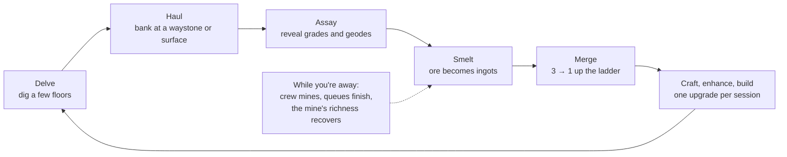
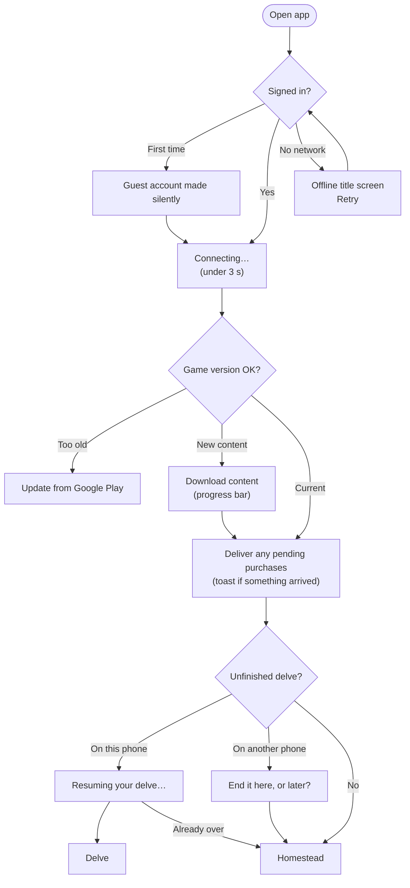
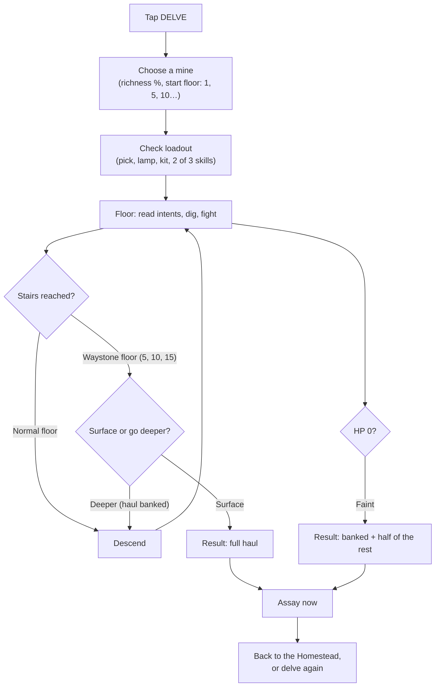

# 22 · The Player's Story: Vision, Scenarios, Flows and Player Thoughts

This document describes Deepforge **the way a player lives it**: what the game is, how a session feels, what happens in the first fifteen minutes, the first week and the first season, how a player moves between screens, and what goes through their head along the way.

It is written to be read start to finish by anyone: owner, designer, engineer, artist, partner or playtester. It does not define rules. The rules live in the linked documents, and **where this narrative and a spec disagree, the spec wins**. Day counts and rates come from the economy model ([04](04-economy-and-progression.md), [Appendix D](appendices/D-economy-simulation.md)). They are predictions until the playtests confirm them.

**Contents**
1. [The game in one minute](#221-the-game-in-one-minute)
2. [The world and its feel](#222-the-world-and-its-feel)
3. [Five promises, felt by the player](#223-five-promises-felt-by-the-player)
4. [One session, told as a story](#224-one-session-told-as-a-story)
5. [The delve up close](#225-the-delve-up-close)
6. [The Assay: the lucky moment](#226-the-assay-the-lucky-moment)
7. [The Homestead: growth you can see](#227-the-homestead-growth-you-can-see)
8. [Together, without pressure](#228-together-without-pressure)
9. [The first fifteen minutes](#229-the-first-fifteen-minutes)
10. [The first day, week, month and season](#2210-the-first-day-week-month-and-season)
11. [A day in the life of five players](#2211-a-day-in-the-life-of-five-players)
12. [Scenarios](#2212-scenarios)
13. [User flows](#2213-user-flows)
14. [What players think, and how the design answers](#2214-what-players-think-and-how-the-design-answers)
15. [How spending feels](#2215-how-spending-feels)
16. [The long view](#2216-the-long-view)
17. [What still has to be proven](#2217-what-still-has-to-be-proven)

---

## 22.1 The game in one minute

Deepforge is a mining RPG for Android phones, made first for players in Taiwan. You inherit your grandfather's abandoned mining camp. You dig down through short, tactical runs into the mine, bring the ore back up, find out how lucky you were, and turn what you found into better tools and a richer home. Your guild digs alongside you, and the whole server slowly unlocks new ages of the world together.

A run takes three to six minutes and is played with one thumb, in portrait, on the train. Every tap breaks a rock, takes a step or strikes a monster. There are no timers inside the mine, so you can think about every move or put the phone away mid-run. Between runs your crew keeps mining and your smelter keeps working, so there is always something waiting when you come back.

**What the player gets, and what they never get:**

| You will | You will never |
|---|---|
| Dig every tile yourself. A better pick visibly breaks rock in fewer taps | Watch an ad |
| See your camp grow from tents to bronze-trimmed halls | Lose your home, buildings, gear, collection or purchases to anyone |
| Get a free lucky reveal after every run, with the odds published | Buy a random box, or pay for better odds |
| Join a free prize draw every week that you can verify yourself | Hit an energy wall that stops you playing |
| Help a guild without being forced to log in at set times | Have an enhancement fail and destroy your item |
| Be great at the thing you like: depth, crafting, collecting or guild play | Fall more than 1.3× behind a spender who plays as much as you (model: 1.1×) |

**Why this game should exist.** The games that serve this audience's favorite motives (collecting, visible wealth, luck and belonging to a group) each charge a price. Idle mining games are satisfying but solitary, shallow and full of ads. Alliance strategy games give status but punish you while you sleep and reward the biggest wallet. Collection games deliver daily luck, but sell it in random packs. Deepforge's promise is **the growth and luck of idle and collection games and the belonging of guild games, without the punishment** ([01 §1.2](01-product-vision.md#12-the-problem-we-solve-for-players)).

---

## 22.2 The world and its feel

**The Hollowlands** are highland frontier villages above *the Deep*: layer upon layer of older worlds, each age of civilization buried under the next. A letter arrives from your late grandfather. His claim at the mouth of Copperhollow is yours now, if you want it. The tents are torn and the forge is cold. You clear the camp, relight the forge and pick up his rusty pick.

The tone is **warm, curious and lightly funny**. The Deep is mysterious, not grim. The things you meet down there are critters and old machines: cave rats, glowmoths, a mole bandit who steals your ore and runs, a burrowing Tunnel Wyrm, a bronze automaton still guarding its works. There is no blood and no long cutscenes. The story comes in one-screen letters and journal pages, in remarks from people around the camp, and in server-wide events where the whole community uncovers the next layer of the past together.

**What it looks like.** 2D characters with big heads, about 2.5 heads tall, a style this audience loves. Warm lantern light pools on earthy rock underground. Above ground, a side-on hillside camp sits over the mine mouth, and every building visibly changes as it levels. Rarity always has a shape as well as a color (grey circle, green diamond, blue shield, purple star, gold sun), so colorblind players read it just as fast.

**What it sounds like.** Mining is percussive and tactile: a *tink* when the pick hits, a *crunch* when rock breaks, a bright chime when ore appears, rising in pitch when you find several in a row. Acoustic folk plays on the surface. In the Deep a low drone rises as your lamp oil runs out, so you *hear* the danger before you look at the gauge.

**How the world moves.** The server lives through **eras**. Everyone starts in the Settlement era of timber and copper. When the community has delivered enough tin, and the server is at least 15 days old, the Bronze era opens for everyone at once, with a new mine, new recipes and taller buildings. The Iron era is planned for about three months in, and four more are sketched beyond it. Older materials stay useful, because later recipes still consume them.

---

## 22.3 Five promises, felt by the player

The design pillars ([01 §1.3](01-product-vision.md#13-design-pillars)) are the rules every feature is checked against. From the player's side, they are five feelings:

| Pillar | What the player feels | What we refuse to do |
|---|---|---|
| **P1 · Every tap digs something** | "I'm always doing something, and I can feel my pick getting stronger." | Waiting screens, energy walls, auto-play as the main way to play |
| **P2 · Your homestead, your legacy** | "Everything I build stays mine. Nobody can raid it, and nothing breaks." | Raids on personal property; enhancements that destroy items |
| **P3 · Lucky, never cheated** | "I get lucky moments for free, I can see the odds, and bad luck has a floor." | Paid random items, hidden odds, fake near-misses |
| **P4 · Many ways to be great** | "I'm known for something, even if I'm not the strongest." | One global power ranking only veterans and big spenders can top |
| **P5 · Stronger together** | "My guild is better because I'm in it, and I never feel forced." | Mandatory attendance at set times; pressure to spend for the group |

---

## 22.4 One session, told as a story

Most sessions follow the same short cycle: **dig, haul, reveal, refine, merge, build, and back down**. This is how one ten-minute session feels.



**1. Coming home.** The phone buzzes on the way to work: *"Your smelter batch is ready."* The app opens in under three seconds on the Homestead. The forge glows, a "ready" bubble bounces over the smelter, and the crew strip says *Collect 38 ore*. One tap gathers everything, and the numbers fly into the inventory.
> *"Oh nice, they mined while I slept."*

**2. Going down.** The big button at the bottom says **DELVE (Copperhollow)**. The site card shows the mine's **richness** at 100%, meaning it is rested and will yield fully. The player starts from floor 1.
> *"Full richness. Let's reach the floor-5 waystone with oil to spare."*

**3. Digging.** The 7×9 grid fills the screen. Each tap breaks dirt, chips stone, or steps forward. A copper vein sparkles two tiles away. A cave rat sits in a pocket, and an arrow over its head says it will step left next turn. The player digs around it, takes the ore, and reaches the stairs with half the lamp oil left. (Full detail in [§22.5](#225-the-delve-up-close).)

**4. Hauling.** On floor 5 the stairs glow gold: a waystone. Surfacing here ends the run with everything safe. Going down also banks the haul so far, but there is no exit before the floor-10 waystone, and the lamp is half empty.
> *"Five more floors on half a lamp? Not today."*

They surface. The result screen shows exactly what they earned: 23 copper chunks (22 tiles × 100% richness × their +6% mining bonus), some coal, quartz, stone and coins, and the richness now at 90%, recovering 5% an hour.

**5. Revealing.** **ASSAY NOW**. The chunks flip one by one: C, C, B, C, A… Then one shakes, cracks and bursts with light: *Geode! Relic: Faded Claim Deed (new).* It goes to the Trophy Hall. The pity meter underneath resets.
> *"Grandfather's claim deed! That's 4 of 6 Settler's Keepsakes."*

**6. Refining and merging.** The ore goes into the smelter queue, which will be done by the next commute. At the forge, three ingots merge into a fitting, three fittings into a component, with a satisfying clunk at each step. **Auto-merge** does it all at once and shows the result before confirming.

**7. One upgrade.** There is almost always one meaningful thing to do: enhance the pick from +2 to +3, start the next Hall upgrade, or hire a fourth crew member from today's three candidates. The enhancement screen says *"At +3, copper veins drop from 3 taps to 2."*
> *"That's worth it. Every vein gets faster."*

**8. Leaving.** The train arrives. They close the app. Nothing is lost: the smelter keeps working, the crew keeps mining, and the mine's richness recovers. Tonight, the guild's weekly depth meter will show the floors they just cleared.

---

## 22.5 The delve up close

The delve is the heart of the game. If digging is not fun with no meta at all, nothing else matters, and the first milestone gate tests exactly that ([20](20-project-plan.md)). Rules are in [03](03-delve-and-combat-design.md).

### The board

The player stands on the top row of a 7-column × 9-row grid. Tiles are dirt, stone, unbreakable bedrock, ore veins (copper, coal, quartz, later tin and rare Starstone) and monster pockets. The stairs are somewhere on the bottom row and are always reachable. Beyond the lamp's light, tiles show as silhouettes, but ore sparkles one tile further out, inviting a detour.

### One tap, one turn

Tapping an adjacent tile does the obvious thing: walk onto open ground, mine rock, or attack a monster. Every action is one turn and burns one unit of lamp oil. After each turn, the monsters do exactly what their icons said they would. Nothing in the delve runs on a clock: the game waits as long as the player needs.

What keeps this from being a chore:

- **The pick gets visibly better.** A tile needs `ceil(tile HP / mining power)` taps. Stone with 20 HP takes 3 taps with the rusty pick and 2 with the copper pick. Copper veins drop from 4 taps to 3 to 2 as the pick improves. Players *feel* these breakpoints without doing any maths, and the enhancement screen names the ones the next level crosses.
- **Monsters announce their next move.** A red tile means "I'll hit you there next turn", and an arrow means "I'll step this way". Reading those signals is the core skill. It turns every floor into a small puzzle: which tiles to open, and in what order, to reach the ore without letting the rat into a corridor beside you.
- **The game warns before it hurts.** The edge of the player's tile glows red in any direction where tapping would cost HP, and shows a skull if that move would knock them out. These warnings are exact: the game computes them from the same rules the server uses.
- **No wasted taps on walking.** Tapping a distant open tile walks the player there automatically, one turn per step, and stops before any step that could hurt. Holding a finger on a rock keeps mining it.
- **Fast enough for the train.** A tap answers within one frame. Players who want it faster can turn on fast mode for monster animations.

### Oil, waystones and the push-your-luck choice

Lamp oil is the run's budget: 180 turns with the rusty lamp, more with better lamps. When it runs out, the dark closes in to one tile of light and costs 1 HP per turn.

Every fifth floor, the stairs are a **waystone**, and waystones are the only exits. Standing on one, the player can **surface** and keep everything, or descend, which **banks** the haul so far and commits them to the next five floors. If HP reaches zero, the delver **faints**: they keep everything banked plus half of what they dug since, and they never lose gear. Running out of oil before the next waystone means the dark slowly drains HP, which ends the same way. Quitting a run counts the same as fainting, so there is no trick in force-closing the app.

That creates the run's central decision:
> *"Floor 5 waystone. Half my oil left, HP is fine… If I go down and can't reach floor 10, I keep only half of whatever I dig on the way. Push for the Wyrm, or surface now?"*

### Bosses

Each mine ends in a boss with a readable pattern:
- the **Tunnel Wyrm** (Copperhollow floor 10) burrows along a telegraphed line and resurfaces;
- the **Cinder Toad** (Emberseam floor 10) spits fire that sets off nearby coal seams, which explode, so the player can mine the coal first or bait the toad into it;
- the **Bronze Sentinel** (Tinreach floor 15) is shielded until the player *mines* its four power conduits, so the fight is literally digging.

A boss's first defeat lets the player **choose** a relic from that mine's set. That is one way the game guarantees collection progress without luck.

### Three ways to play: Vocations

| Vocation | Style | Signature skills |
|---|---|---|
| **Engineer** (the starter) | Demolition: mining and fighting at once | Blast Charge (3×3 explosion), Auto-Turret, Field Repair |
| **Guardian** | Frontline: stand and take it | Shield Bash (push and stun), Bulwark (block and reflect), Tremor Strike |
| **Ranger** | Precision and scouting | Piercing Shot, Snare Trap, Flare (reveals ore and monster plans) |

The second and third Vocations unlock at character levels 5 and 10. Skills recharge in turns; there is no mana. The player brings two of their three skills, and choosing which two before each run is a small, meaningful decision. Switching Vocation at the camp is free.

### Special delves

- **Deep Rift (weekly):** one mine with **the same layout for everyone on the server** that week, plus two twists such as *Low Oil* or *Swarm*. Everyone races for depth on identical floors. Sharing routes and guides is encouraged.
- **Colossus (guild boss):** a 40-turn single-floor fight. Damage adds up across the guild.
- **Proving Grounds (first live update):** fights against computer-controlled copies of other players, with gear differences halved so skill decides close fights.

---

## 22.6 The Assay: the lucky moment

The Assay is the game's signature ritual ([02 §2.5](02-game-design-document.md#25-the-assay-ritual)), and it is free apart from a 1-coin fee per chunk.

Ore comes out of the mine as **unassayed chunks**. At the Assay Office they flip over one at a time to reveal their **grade**:

| Grade | Chance | Worth | How it feels |
|---|---|---|---|
| C | 60% | 1 ore | The usual |
| B | 30% | 1 ore, slightly better crafting quality | A small smile |
| A | 9% | 2 ore, better quality | "Nice!" |
| S | 1% | 3 ore, much better quality, with a gold shimmer | Screenshot moment |

Now and then a chunk **cracks open as a geode**, with its own sound, a camera shake and a light burst. Inside is a gem (70%), a collectible **relic** (25%) or a rare Starstone shard (5%).

**Why it feels fair:**
- An **Odds** button lists every table in the current game version, plus the player's own bonus from the Prospecting profession.
- The **Prospector's Instinct** meter fills with every chunk that isn't a geode, and is always on screen. At 250, the next chunk is a guaranteed geode. Bad luck has a floor, and the player can see exactly how far away it is.
- The tutorial's first assay contains a scripted geode with a relic, so every player has a lucky moment within their first five minutes.
- Nothing about the odds can be bought. The only things for sale here are cosmetic animation skins.

**How often.** In the model, a casual player (about four runs a day) gets roughly **one geode every day or two**. An engaged player gets about two a day. That keeps geodes special without making them rare enough to frustrate.

---

## 22.7 The Homestead: growth you can see

The Homestead is home. It is the first screen after loading and the place every session starts and ends.

### Buildings

The **Homestead Hall** (levels 1–15) is the master building: it sets how high everything else can go. Around it are the **Smelter** (ore becomes ingots, on a timer), the **Forge** (instant merging and timed crafting), the **Assay Office**, the **Warehouse**, **Crew Quarters**, the **Trophy Hall** and the **Workshop** for jewelry-like trinkets. One building upgrades at a time. Timers start at five minutes and grow to many hours later on, so a long upgrade becomes an overnight anticipation rather than a wall.

As levels rise, the camp changes look: tents, then timber, then brick, then bronze-trimmed halls. Decorations (earned or bought) are purely cosmetic, and visitors can see them.

### The merge ladder

All metal goes up a simple ladder, always **3 → 1**:

```
3 ingots → 1 fitting → 3 fittings → 1 component → 3 components → 1 assembly
```

Each merge is instant, makes a satisfying sound and costs a few coins. Recipes ask for components and assemblies, so the ladder makes progress feel physical: a pile of ingots becomes one heavy assembly in your hands. The quality of a crafted item comes from the assay grades of the ore that went into it, so lucky S-grade chunks also mean better gear. Quality is never random beyond that.

### Gear that never breaks

The delver has a pick (mining power), a lamp (oil and light), a kit (fighting stats) and trinkets. Enhancement from +0 to +10 **always succeeds**. Crafting the next tier keeps part of your enhancement. Nothing you own can break, be lost in the mine or be taken by another player.

### The crew

Hired miners each produce ore and coal every hour, even while the player is offline, up to 12 hours' worth. Each day the Crew Quarters board shows three candidates with visible traits: *Sturdy* (+15% ore), *Steady* (works longer offline), *Coal-Wise*, *Lucky*. You pick one with coins. There is no random paid recruitment. Crew ore is plain grade C and never contains geodes, so **the rare, exciting finds always come from actually playing**.

### Collections and the Trophy Hall

At launch there are 18 relics in 3 sets. Completing a set gives a small permanent bonus, such as +2% chunk yield or an extra crew slot. A duplicate turns into Relic Dust, and 100 dust crafts *any specific* missing relic, so the last relic in a set never becomes a lottery. Boss first clears, guild chests and Mineralogy Index achievements add guaranteed progress. The aim is that a casual player completes their first set within 30 days. The Trophy Hall shows it all off, and friends can visit.

### Richness instead of energy

Each mine has a **richness** value per player. Every run there lowers it by 10% (never below 25%), and it recovers 5% an hour. The player can **always** play. A tired mine still yields, just less, and the other mine is probably fully rested. This gently encourages switching mines and coming back later, without the "out of energy, come back in 3 hours or pay" wall of many mobile games. It also limits bots and grinders: in the model, a player doing 20 runs a day ends only about 1.1× ahead of one doing 10.

### Professions: many ways to be great

**Mining**, **Smithing** and **Prospecting** each level up separately as you do that activity, each with its own leaderboard. A player who mostly assays and collects becomes a known Prospector. A crafter climbs the Crafting Mastery board. Nobody needs to be the strongest fighter to be recognized.

---

## 22.8 Together, without pressure

Every social feature is **asynchronous**: nothing needs two players online at the same moment. Chat is live; gameplay never waits for anyone ([05](05-multiplayer-guilds-and-territory.md)).

**Friends (up to 50).** Visit a friend's camp to see their Trophy Hall, decorations and best Deep Rift run. Leave a daily **Cheer**, which gives them a small yield boost. Send a small fixed gift of ore and coal to up to ten friends a day.

**Guilds (up to 30, growing to 40).**
- **Commissions:** a member asks for materials, say 60 bronze ingots, and guildmates fill the request in parts, earning **Guild Marks**. This is how crafters and miners help each other at launch, without an open market that bots would exploit.
- **Deep Expedition:** every floor anyone clears in the week adds to the guild's shared depth meter. Milestones unlock a weekly chest for everyone who contributed at least 10 floors.
- **Colossus:** a guild boss three times a week, with two attempts per member per day. When it falls, **everyone who attacked gets the full reward**. Contribution reorders the damage ranking but never shrinks anyone's prize.
- **Research:** leaders choose upgrades from a tree that can't be maxed, so each guild develops its own identity: faster smelting, deeper start floors, more members.
- **Safety:** there are no private messages at launch. Links are blocked, phone numbers and LINE IDs are masked, and leaving a guild is free.

**The Motherlode Draw (every week).** Players earn up to 20 free tickets a week by playing normally: runs past floor 5, daily and weekly objectives, guild expedition floors. On Sunday at 21:00 the draw reveals 8 grand winners and 88 runners-up per server. Everyone with at least 5 tickets gets a consolation prize. **No ticket can ever be bought.** The draw is provably fair. Before the week starts, the game publishes a sealed fingerprint of a secret number. After the draw closes, that secret is combined with a public random number (from the drand beacon) that did not exist until then, so nobody, not even the operator, can steer the result. Any player can tap **Verify** to recompute it on their phone.

**Fame.** There are seven leaderboards per server: weekly Deep Rift depth, seasonal Mining Yield, Crafting Mastery, Collection, Rising Star (only for new accounts), Guild Contribution and Fortune (draw wins, which is pure luck and labelled as such). There is deliberately **no single power ranking**. The **Hall of Fame** on the server plaza permanently records boss first-clears, era milestone deliverers, draw winners and champions.

**Shared story.** Era unlocks and **World Discovery** events are server-wide projects. Miners deliver strange new ore, prospectors assay it, smiths craft experiments, and guilds clear special floors. Each stage reveals a story card, and the last opens something new for everyone.

**Later, for players who want more competition:** Proving Grounds async duels (first live update), escrowed **Trade Contracts** with price limits (second update), and seasonal guild **Claims** territory with scheduled one-hour battle windows (third update). Even then, only the Claim and its bonus can be lost. Homes, gear and collections are never at stake.

---

## 22.9 The first fifteen minutes

The tutorial's rule: **no screen holds the player for more than 20 seconds without them doing something**, and they are hands-on within the first minute ([02 §2.12](02-game-design-document.md#212-first-time-user-experience-ftue)).

| Time | What happens | What the player is thinking | What the game is teaching |
|---|---|---|---|
| 0:00 | Choose language, confirm birth year. A guest account is made silently | *"No sign-up form. Good."* | Nothing yet; zero friction |
| 0:20 | Grandfather's letter, one skippable screen | *"Cute art. A family mine?"* | The premise |
| 0:40 | A hand-built first floor: dig 3 dirt and 2 stone | *"Tap, crunch. Okay, this feels nice."* | Tap to mine or move; mining power and HP numbers |
| 1:30 | The first copper vein sparkles; mine it | *"Shiny! Chunks!"* | Ore and the haul counter |
| 2:00 | A cave rat with an arrow over its head | *"It's telling me where it'll move… so I hit it first."* | Reading monster intent |
| 3:00 | Stairs, floor 2 | *"What's that bar going down?"* | Lamp oil; descending |
| 4:30 | Surface (allowed early in the tutorial) | *"I keep what I brought up."* | Banking |
| 5:00 | Assay Office: chunks flip… and a **geode** with a relic | *"WHOA. What else is in there?"* | Grades, geodes, the Trophy Hall. The first lucky moment is guaranteed |
| 6:30 | Smelter: queue ore, the first batch finishes instantly | *"Ore into bars."* | Smelting |
| 7:30 | Forge: merge 3→1 twice, then craft the **Copper Pick** with grandfather's strongbox ingots | *"Stone takes 2 taps now instead of 3!"* | The merge ladder; gear; breakpoints |
| 9:00 | Upgrade the Homestead Hall; the first speed-up is free | *"My camp's growing."* | Building, timers, Hasten |
| 10:00 | A real run in Copperhollow, with richness shown | *"Now I'm on my own. Can I reach floor 3?"* | The real loop |
| 14:00 | Daily objectives and the draw ticket | *"Five small goals, and a free prize draw?"* | Daily rhythm; the draw |
| 15:00 | **Name your delver** | *"I'm keeping this one."* | Naming comes last, once the player is already invested |

By minute 15 the player has dug, fought, banked, been lucky, crafted a better tool, felt it work, upgraded their home and been given reasons to come back.

---

## 22.10 The first day, week, month and season

These timelines use the model's **casual** player (about four runs a day in three sessions) and **engaged** player (about ten runs a day in five sessions). The day numbers are medians from the economy simulation ([04 §4.12](04-economy-and-progression.md#412-pacing-targets-and-simulated-results)).

| When | Casual player | Engaged player | How it feels |
|---|---|---|---|
| **Day 1** | Copper Pick, first relic, first real runs, first daily objectives | Same, plus several floors deeper | *"I get it, and I want one more run."* |
| **Days 2–6** | First boss (Tunnel Wyrm) around day 4–6; chooses a relic | First boss around day 2–3; Hall level 5 by day 4 | *"I beat the Wyrm!"* The Starter Satchel offer appears once, after the first boss |
| **Week 1** | Hall 5 around day 7: can create a guild, unlocks realm chat | Joins or founds a guild; first Colossus; first full draw week | *"I'm part of something."* |
| **Day 7+** | Eligible for the draw (account a week old, Hall 5, account linked) | Same | *"Sunday night: did I win?"* |
| **Day 15+** | The server's Bronze era opens once the community has delivered enough tin | Racing to be among the first to deliver | *"The whole server did that."* |
| **Weeks 2–4** | Level 20 (the Settlement-era cap) around day 29 | Level 20 around day 14; Bronze Pick around day 19 | Rhythm: daily goals, weekly guild goals, Sunday draw |
| **Day 30** | Target: first relic set complete | Halfway through the season pass | *"My Trophy Hall is filling up."* |
| **Day 40** | **Bronze Pick** (the second big tool) | Hall 10 around day 24; Starstone gear in sight | *"Tinreach rock finally takes 2 taps."* |
| **Day 42** | Season ends. About 90% of the free pass done, 100% with the final-week boost | Pass done around day 31 | Season rewards; the Hall of Fame updates; a new season starts |
| **Day 90** | Still climbing Bronze-era buildings | Bronze era complete; the Iron era is due around day 91 | *"What's next?"* The next era answers |

**The emotional arc:**
1. **Week 1: discovery.** Everything is new. Upgrades come every session, and the first boss and the first relic are big moments.
2. **Weeks 2–4: rhythm and belonging.** Progress slows to one meaningful upgrade per session. What carries the player now is the daily goals, the guild's weekly targets, the Sunday draw, the Deep Rift race and the growing collection.
3. **Months 2–3: mastery and identity.** The player knows their Vocation, has a reputation (deep diver, crafter, collector or guild officer) and starts looking forward to the next era.

**The known weak spot:** between the Copper Pick on day 1 and the Bronze Pick around day 40, a casual player gets no big tool upgrade. Enhancements, building levels, collections, objectives and the draw have to keep that stretch exciting. This is the biggest retention risk, and it is measured from the first closed test ([§22.17](#2217-what-still-has-to-be-proven)).

---

## 22.11 A day in the life of five players

The personas are hypotheses to validate in playtests ([01 §1.4](01-product-vision.md#14-target-audience)). Names are illustrative.

### Yu-Ting, 28: the Commuter Collector
Office worker in Taipei. Plays 2–4 times a day for 5–10 minutes on the MRT, one-handed.

- **07:40, on the train.** Collects crew ore, queues the smelter, plays one run in Emberseam because Copperhollow's richness is still recovering. Assays: a B, an A, no geode. The pity meter is at 212/250.
  > *"38 more chunks and I'm guaranteed one."*
- **12:30, lunch.** One run, then the assay. The meter is close, and a geode cracks: a duplicate relic, which becomes 25 dust. That makes 100.
  > *"I'll craft the Petrified Wyrm Egg with the dust. One left for the set!"*
- **21:00, on the sofa.** Daily objectives done, draw ticket earned. Visits a guildmate's Trophy Hall and leaves a Cheer.
- **What keeps her:** collecting, cute art, a lucky moment most days, a complete set she can show off.
- **What could lose her:** a long stretch with no geode, or a week where the Trophy Hall doesn't change. Pity, dust and guaranteed relic sources exist to prevent that.
- **Likely spending:** the monthly Charter (auto-assay, a monthly cosmetic) and an occasional decoration.

### Chih-Hao, 34: the Guild Strategist
Organized raids in old PC MMOs. Plays evenings, 30–90 minutes.

- **20:30.** Checks the guild screen: the Colossus is at 41%. Uses both attempts, timing Bulwark around the boss's big hit.
- **21:00.** Fills two commissions for bronze ingots, picks the next research node ("Deep Surveying") and posts in guild chat: *"Expedition at 612/800 — 20 floors each tonight and we hit tier 3."*
- **What keeps him:** leadership, a visible guild identity, the weekly Colossus, the Hall of Fame plaque for the first Bronze delivery.
- **What could lose him:** members going quiet, or no competitive layer later. Proving Grounds and Claims are planned for that.
- **Likely spending:** Pass, Charter, guild cosmetics (a voluntary group purchase), the Hasten speed-up.

### Pei-Shan, 22: the Cozy Builder
University student. Short bursts on weekdays, long sessions at weekends.

- **Saturday afternoon.** Rearranges the camp's decorations, visits five friends' camps and sends gifts. Plays a few relaxed runs, always surfacing at the first waystone.
  > *"I never push for the boss with low HP. I like that I can just… play safe and still progress."*
- **What keeps her:** decorating, calm progress, friends, an economy where nothing fails or gets taken.
- **What could lose her:** pressure, competition shoved in her face, or a guild that demands too much. Guild objectives can always be swapped for solo ones.
- **Likely spending:** cosmetics only.

### Wei, 19: the Min-Maxer
Reads strategy guides on the Bahamut forums. Plays long sessions.

- **Monday 05:00.** The new Deep Rift seed drops: same layout for everyone, *Low Oil* and *Brittle* twists. Plans a route, uses the three daily attempts, and posts the route on the forum.
  > *"Brittle halves stone HP, so my +3 pick breaks stone in one tap this week. That changes the whole route."*
- **What keeps him:** breakpoints, depth records, leaderboards, the Rising Star race on a fresh server.
- **What could lose him:** running out of goals. In the model, the most hardcore players finish Bronze-era gear around day 86, so weekly Deep Rift records, collections and Proving Grounds are there to keep them busy.
- **Likely spending:** mostly free, maybe the Pass.

### Mr. Lin, 41: the Returning Veteran
Lapsed MMO player with money but little time. One or two short sessions a day.

- **22:30.** Collects up to 16 hours of crew output (his Charter extends the usual 12), claims the stacked Charter Aurum, hastens a building timer, plays one run.
  > *"I'm not falling behind just because I can't play all day."*
- **What keeps him:** respectful pacing, offline progress, catch-up systems, status without grind.
- **What could lose him:** feeling that time spent is wasted, or that the young players have outgrown him.
- **Likely spending:** Charter, Pass, Hasten. The fairness cap means his spending speeds him up without letting him dominate.

---

## 22.12 Scenarios

Short stories of situations every player will meet, with what they think and what the game does. The formal acceptance versions are in [02 §2.13](02-game-design-document.md#213-player-journeys-scenarios) and [08](08-requirements-specification.md).

### The interrupted run
Yu-Ting starts a run from floor 1, passes the floor-5 waystone (banking the haul) and is on floor 7 when the train reaches her stop. She pockets the phone mid-move.
> *"Ugh, did I just lose the run?"*

The game saved every move on the phone as she played. If she reopens it while the run is less than two hours old, it continues exactly where she left it, because nothing in the mine runs on a clock. If she only reopens it that evening, the run has expired, so the game sends her saved moves to the server, which settles it **as if she had fainted at her last move**: everything banked at floor 5 is hers, plus half of what she dug on floors 6 and 7. A message explains it.
> *"Okay, I still got most of it."*

### A bad run
Wei pushes past floor 5 with low HP, misreads a mole bandit and faints on floor 8.
> *"Ugh. Greedy."*

He keeps the banked haul from floors 1–5 and half of floors 6–8. His gear is untouched. The result screen shows exactly what he kept. The loss stings, but only a little. That's the point: the risk is real enough to matter, never big enough to make someone quit.

### Back after a week away
Mr. Lin was travelling for six days.
> *"I'm probably way behind now."*

He opens the app to find his crew stopped at their 12-hour cap (nothing lost, just paused), every mine at full richness, his Charter Aurum stacked for up to seven days, and two days of **Rested Objectives** he can claim by doing double targets. Login reward calendars count any 7 of 14 days, so there was never a streak to break.
> *"That's… a nice welcome back."*

### Underground, no signal
Pei-Shan plays a run on the MRT through a tunnel with no connection. The run plays normally, because every move is computed on the phone. A small cloud icon shows "syncing". When the signal returns, her moves upload in the background. If she finishes the run offline, the result screen says *"Saved. We'll settle this run when you're back online."* The game never predicts loot on the phone, so what she sees after settlement is always the true result.

### Guild night
Chih-Hao's guild faces the Colossus on Hard. Members drop in through the evening at their own pace: no fixed raid time. When it falls at 23:10, everyone who attacked, including the member who only managed one weak attempt, gets the full tier reward. Guild chat fills with stickers.

### Draw night
Sunday, 20:00: the draw closes. The app counts down. At 21:00 the result goes up, and the server's Hall of Fame shows 8 grand winners and 88 runners-up. Yu-Ting isn't one of them, but her 14 tickets earn the consolation prize: 500 coins and 25 Relic Dust. A sceptical player in realm chat taps **Verify**. The phone recomputes the result from the secret the game sealed before the week started and the public random number drawn after the close, and gets the same winners.
> *"Okay, it's actually fair."*

### The first purchase
After beating the first boss, Mr. Lin sees a one-time **Starter Satchel** offer (US$1.99 tier) with its fixed contents listed: 4 copper components, 120 Aurum and a pick skin. He buys it through Google Play. The items appear within about two seconds. Had his connection dropped right after paying, the game would have delivered the purchase on the next launch. The game also suggests linking his account to Google or LINE so the purchase is safe if he changes phones.

### A new server opens
Server tw-003 opens on a Friday evening. Wei starts fresh to race for the Rising Star board and the first-era milestones. A server-wide tin progress bar appears, and the Bronze era can open on day 15. His guild delivers the most tin first and earns a permanent Hall of Fame plaque.

### A new phone
A player switches phones and taps **Sign in with LINE** on the title screen, and everything is there. A guest account that was never linked can't be recovered this way, which is why the game asks players to link at three natural moments: after the first boss, before the first purchase and after joining a guild.

---

## 22.13 User flows

### Opening the app



During maintenance, a localized screen shows when the game will be back, in Taiwan time, with links to the community channels.

### Navigation map

The bottom bar has **Home · Delve · Forge · Guild · More**. Every frequent action sits in the bottom 40% of the screen, within thumb reach.

| From | The player can reach |
|---|---|
| **Home** (Homestead) | Every building (tap to open, or to collect if something is ready), crew collect-all, daily objectives, draw summary, mail, the big DELVE button |
| **Delve** | Site select (richness, start floor, boss status), loadout (gear, 2 of 3 skills), the delve itself, the result, then the Assay |
| **Forge** | Merge (tap or hold to repeat; auto-merge with a preview), Craft (recipes and timers), Enhance (shows the breakpoints the next level crosses) |
| **Guild** | Members, Commissions, Research, Events (Colossus, Deep Expedition), Chat |
| **More** | Inventory and gear, Vocation, Trophy Hall, Objectives and Pass, Leaderboards and Hall of Fame, Draw, Store, Friends, Settings |

### A delve, step by step



Inside a floor, the player's micro-loop is: **look** at the intent markers and danger edges → **decide** where to go → **tap** (or hold, or tap far away to walk) → **see** the monsters react → repeat.

### Production

1. **Collect** crew output (one tap on the crew strip).
2. **Assay** any chunks, if not already done after the run.
3. **Smelt:** queue ore in the smelter; copper and tin take minutes, bronze needs coal too.
4. **Merge:** auto-merge up to the tier the next recipe needs.
5. **Spend:** craft the next item, enhance one piece of gear, or start the next building upgrade. The Warehouse and the sell screen show what's *reserved for upcoming upgrades*, so the player never sells what they'll need next.

### Buying something

1. **Store** → choose a product. Contents, price (from Google Play, in local currency) and any weekly limit are always shown in full.
2. The Google Play payment sheet appears.
3. The server checks the purchase with Google and delivers it. Items appear within about two seconds.
4. If anything interrupts this, the next launch finishes the delivery. Players under 18 have a monthly spending limit, and everyone can set their own.

### A guild week

| Day | What happens |
|---|---|
| Monday 05:00 | Weekly reset: new Deep Expedition, new Deep Rift seed, the draw opens, a Colossus cycle starts |
| Through the week | Every floor anyone clears raises the guild's depth meter. Commissions get posted and filled |
| Wednesday, Friday 05:00 | New Colossus cycles (48 hours each, 2 attempts per member per day) |
| Sunday 20:00 / 21:00 | The draw closes, then the reveal |
| Sunday 23:59 | Deep Expedition ends; chests go to everyone with 10 or more floors |

### The daily rhythm

The day resets at **05:00 Taiwan time**, not midnight, so late-night players finish their evening naturally. Each day brings five objectives drawn from at least three different activities, three new crew candidates, three Deep Rift attempts and fresh gift limits. Notifications are opt-in, limited to two non-essential pushes a day, and silent between 23:00 and 08:00.

---

## 22.14 What players think, and how the design answers

Every mobile game player brings suspicions from games that burned them. This table lists the thoughts we expect, when they occur, and what the design does about them.

| The player thinks… | When | The design's answer |
|---|---|---|
| *"Is this just another idle tapper?"* | First minute | You dig every tile yourself. Monsters plan moves you can read; each floor is a small puzzle |
| *"This is going to hit me with an energy wall."* | After several runs | There is no energy. A mine's richness drops with use and recovers, but you can always play, and the other mine is probably fresh |
| *"I fainted. Did I lose everything?"* | First faint | Banked haul is safe, half of the rest is kept, gear is never lost |
| *"The odds are rigged."* | At the Assay or the draw | The Odds button shows every table. The pity meter is always visible. The draw can be verified by anyone |
| *"Spenders will crush me."* | Seeing a high-level player | Nothing random or power-critical is sold. Paid power stays within 1.3× of a free player who plays the same amount (model: 1.1×), and the spender's lead shrinks over time |
| *"Enhancement will fail and break my gear."* | First enhance | It always succeeds. Nothing breaks |
| *"Someone will raid my base while I sleep."* | Week 1 | Impossible. Your home and belongings can never be attacked. Later territory battles are guild-level, seasonal and scheduled |
| *"I missed three days. I'm behind."* | Returning | Crew output waits up to 12 hours, mines recover to full, missed objectives bank for 2 days, login calendars count any 7 of 14 days |
| *"My guild will kick me if I don't log in."* | Joining a guild | Nothing needs players online together. Colossus rewards everyone who attacked. Guild objectives can be swapped for solo ones |
| *"Is it worth paying?"* | Looking at the Store | Fixed, fully listed contents. The Charter pays out over time and unclaimed days stack. Buying the Pass late grants every tier already earned |
| *"Why can't I message that player?"* | Wanting to chat privately | No private messages at launch, for safety. Guild and realm chat are open |
| *"This is getting repetitive."* | Weeks 2–4 | Weekly Deep Rift layouts and twists, rotating objectives, events, collections, the draw and eras. This is the real risk, and it is measured |
| *"I have nothing left to do."* | Top players, around day 77–90 | Deep Rift records, collections, Proving Grounds (the first live update) and the next era |
| *"What do I do with 10,000 copper ingots?"* | Late Bronze era | Guild commissions and expedition deliveries absorb them, and Iron-era recipes still use copper and bronze |

---

## 22.15 How spending feels

Deepforge earns money without ads and without selling luck ([07](07-monetization-and-business-model.md)). From the player's side:

**What can be bought:**
- **Prospector's Charter** (US$4.99 a month, or a 30-day prepaid version like the familiar "monthly card"): 30 Aurum a day (unclaimed days stack up to 7), an extra smelter slot, a longer offline cap, auto-assay, a monthly cosmetic, a badge.
- **Delver's Pass premium** (US$9.99 a season): extra rewards and the season's cosmetic set on top of the free track. It contains no exclusive power.
- **Aurum** (the premium currency), for cosmetics, timer speed-ups (capped at 8 hours a day) and conveniences. The first purchase of each pack gives double.
- **Fixed bundles:** the one-time Starter Satchel, a Founder's Pack in the launch month, and Supply Crates (fixed contents, 2 a week).

**What can never be bought:** random boxes; better odds; relics, gems or Starstone; draw tickets; ranking points; gear above the current era; enhancement success (it is always 100% anyway).

**How the game behaves:** no fake countdowns, no "last chance" on permanent items, no pop-up ambushes, no pre-ticked boxes, prices always shown. Large purchases get an extra confirmation showing the month's total. Players under 18 have a monthly limit (NT$3,000 by default in Taiwan), and anyone can set a lower personal cap that takes effect immediately.

**What a free player can expect:** every piece of gear, every building level, every relic and every draw prize is reachable by playing. Spending saves time and buys identity. It does not buy victory.

---

## 22.16 The long view

**The yearly rhythm.** Seasons last six weeks. Each brings a new Pass and cosmetic set, seasonal leaderboards, a themed event in week 2, a mid-season balance pass, a weekend double-drop and a final week with boosted Pass progress. Holiday events replace the themed event when they coincide. Lunar New Year is the biggest (the launch is planned 8–10 weeks before it), and Ghost Month gets only gentle, respectful content and no launch or big marketing push.

**The roadmap after launch:**

| Update | Roughly when | What players get |
|---|---|---|
| Launch | — | Settlement and Bronze eras, 3 mines, 3 bosses, guilds, the draw, the Pass |
| First live update | 6–8 weeks after launch | Proving Grounds: async duels with balanced stats |
| Second live update | About day 91 | The Iron era; escrowed Trade Contracts between players |
| Third live update | About 6 months | Claims: seasonal guild territory battles in scheduled windows |
| Later | Unscheduled | Eras IV–VII: Crystal, Steam, Ancient, Astral |

The world's story keeps being told through era unlocks and World Discovery events, each a server-wide mystery that every kind of player contributes to.

---

## 22.17 What still has to be proven

The design is concrete, and its economy has been simulated and checked automatically. But fun and retention can only be proven by real players. The project's gates are set up to catch failure early ([20](20-project-plan.md), [16](16-analytics-and-kpis.md)):

| Question | How it is tested | Pass mark |
|---|---|---|
| Is digging fun on its own, with no meta? | First prototype playtest, 20+ players | At least 60% ask for "one more run"; median of 3 or more voluntary runs |
| Do people come back? | Closed alpha | Day-1 return ≥ 35%, day-7 ≥ 12% |
| Is it a business? | Soft launch in Hong Kong and Macau | Day-1 ≥ 38%, day-7 ≥ 13%, day-30 ≥ 5%, at least 2.5% paying by day 30 |

**The risks a player would notice:**
- **The mid-game stretch.** A casual player waits about 40 days for the second big tool. If collections, objectives and events don't carry that stretch, players drift away.
- **Turn-based pace.** Some players may find a turn-based mine slow. Hold-to-mine, tap-to-walk and fast mode exist for that, and the first playtest will show whether it is enough.
- **Richness read as energy.** If players see the yield drop as a disguised energy wall, the presentation (or the numbers) must change.
- **Social density.** Guild features need active guilds. Server sizes and planned server merges have to keep guilds lively.

There is one business fact behind all of this. With the planned prices and no ads, each player is worth about US$1.60 over six months, too little to buy growth through advertising. **The game grows only if players enjoy it enough to stay and tell their friends.** Everything in this document serves that one goal.

Further detail: risks are scored in [Appendix F](appendices/F-risk-register.md), and open decisions are listed in [Appendix G](appendices/G-open-questions.md).
